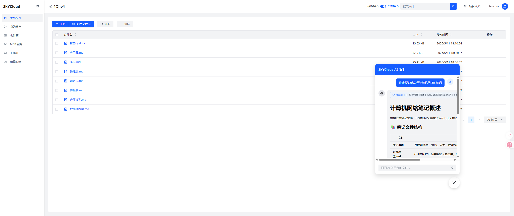
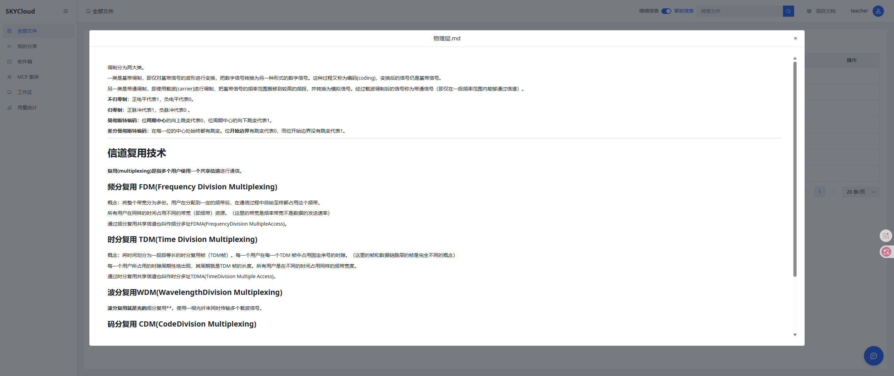
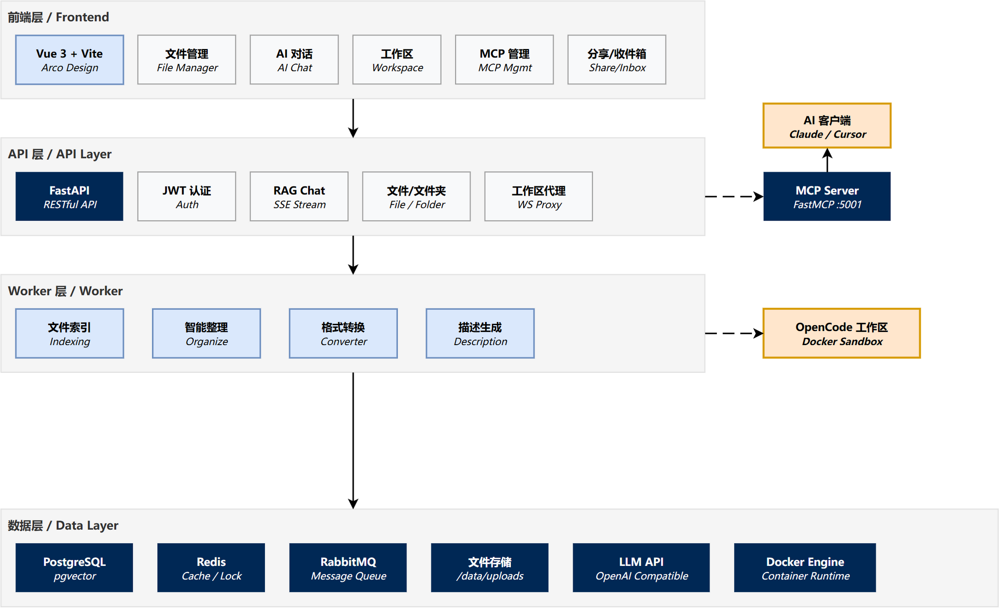
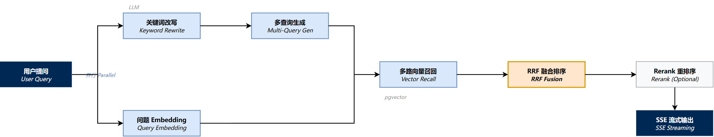
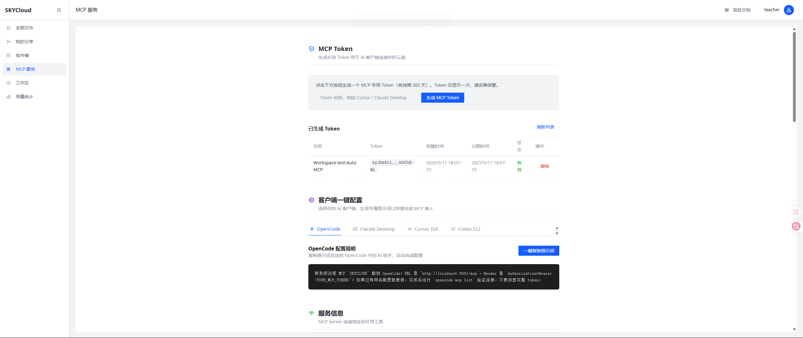
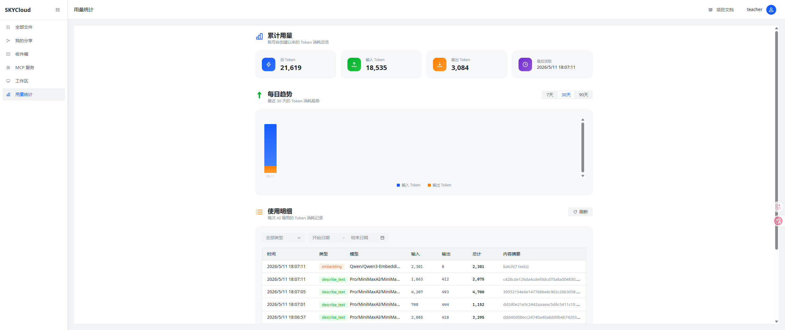
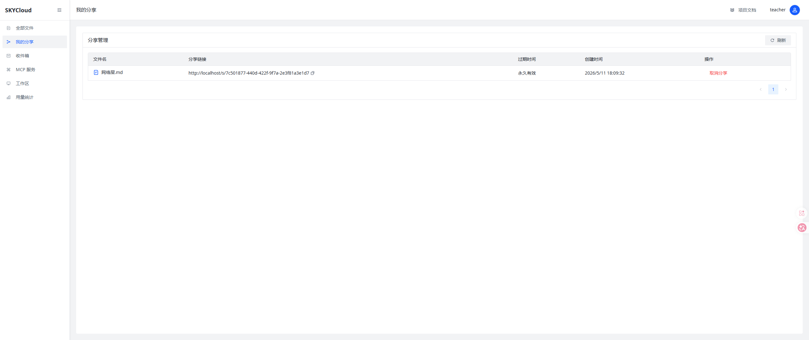
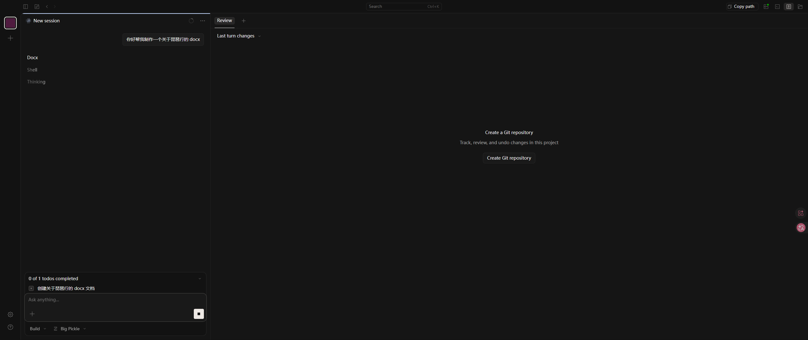

<div align="center">
  <h1>SKYCLOUD</h1>
  <p><strong>AI 驱动的云文件管理平台</strong></p>
  <p>
    
    
    
    
    
    
  </p>
  <p><a href="./README_EN.md">English</a></p>
</div>

---

SKYCloud 是一个 AI 增强的云文件管理系统，提供从文件存储、智能检索到自主执行的一站式体验。

## 功能亮点

- **文件管理** — 上传（分片 / 秒传）、下载、预览、批量操作、文件夹树、格式转换
- **AI 对话（RAG）** — 多维关键词改写 → Multi-Query 向量召回 → RRF 融合 → 可选 Rerank → SSE 流式输出，支持图片引用
- **双模式 AI 助手** — 快速模式与专家模式使用独立会话；专家模式通过受控 OpenCode Runtime 支持工具调用、权限确认、取消与 Diff
- **AI 文件整理** — LangGraph ReAct Agent 自动分类，增量 / 全量模式，整理后收件箱通知
- **全能工作区** — 独立 Docker 沙箱 + MCP 协议，AI Agent 可读写云盘、运行代码、自动化任务（Manus 风格）
- **MCP 服务** — 16 个工具 / 4 个 Prompt / 2 个 Resource，Claude Desktop、Cursor 等客户端直接接入；支持不依赖 curl 的 `upload_file` 直传
- **分享 & 收件箱** — 带过期时间的分享链接、系统通知推送
- **Token 用量追踪** — 对话 / 索引 / 整理的消耗统计，含管理员汇总视图
- **性能优化** — Bloom Filter 权限前置、Redis 缓存、RabbitMQ 异步索引、并行 Embedding

| 智能助手对话                           | 文件预览                             |
|----------------------------------|----------------------------------|
|  |  |

## 架构



| 层级      | 技术                                                   |
|---------|------------------------------------------------------|
| 后端      | FastAPI · SQLAlchemy · Pydantic                      |
| AI      | LangChain · LangGraph · OpenAI API（兼容 SiliconFlow 等） |
| 向量库     | PostgreSQL 15 + pgvector（1024 维）                     |
| 队列 / 缓存 | RabbitMQ 3.13 · Redis 7                              |
| 前端      | Vue 3 · TypeScript · Vite · Arco Design              |
| MCP     | FastMCP（Streamable HTTP）                             |
| 部署      | Docker Compose                                       |

## 快速开始

> 环境要求：Python 3.11+、Docker + Docker Compose；运行时支持 arm64 和 amd64。

```bash
git clone https://github.com/TianyaSKY/SKYCloud && cd SKYCloud
python3 scripts/generate-env.py
python3 scripts/build-runtime-image.py --env-file .env
python3 scripts/build-minio-image.py --env-file .env
# 编辑 .env，至少填写 Chat 和 Embedding 模型的 API_URL / API_KEY / MODEL
docker compose up -d --build
docker compose exec backend-api python -m entry.bootstrap_admin --username admin
```

运行时构建脚本校验锁定的官方 CLI 压缩包 SHA-256，使用固定 glibc 基础镜像和 Debian 软件包快照，并将本机不可变镜像 ID 写入 `.env`，保留其他配置与密钥。官方 Alpine 镜像的 PTY 原生库存在 glibc 兼容问题，因此部署必须先执行此构建步骤；换 Docker 主机时重新构建。沙箱普通 `/tmp` 保持 `noexec`，仅限额 64 MiB 的私有 `/tmp/.native` 允许加载 PTY 原生库。

工作区 UI 使用独立主机上的 HttpOnly 会话，单次租期十分钟。主页面打开期间每五分钟申请一次性票据，通过隐藏 iframe 更新 Cookie，保留编辑界面；返回可见页面时也会续期。续期失败会关闭工作区入口。终端和事件流仍受各自租期限制，重连会使用当前 Cookie；权限撤销不依赖页面主动关闭。

浏览器访问令牌只保存在内存中，有效期十五分钟；刷新凭证使用 host-only HttpOnly Strict Cookie，HTTPS 下带 Secure 和 `__Host-` 前缀，绝对有效期七天且每次使用都会轮换。Redis 只保存哈希索引和会话元数据。重放旧刷新凭证、退出登录或修改密码会撤销访问权限；浏览器通过同源 Web Lock 串行化各标签页的 Cookie 轮换。Redis 故障时续期拒绝，不会静默重建会话。非 localhost 部署必须配置 HTTPS `APP_ORIGIN`。升级会清除历史 localStorage 登录信息，需要重新登录。

前端 CSP 禁止内联脚本和 eval；样式保留组件库所需的 inline 支持。部署自定义运行时域名时，将 `RUNTIME_UI_CSP_SOURCE` 配置为对应的 CSP frame-source，例如 `https://*.runtime.example.com`，与 `RUNTIME_UI_ORIGIN_TEMPLATE` 一致。`/auth/refresh` 和 `/auth/logout` 必须使用同源 POST、精确的 Origin 及 `X-Skycloud-Session: 1` 请求头。

启动后访问 `http://app.skycloud.localhost`（默认端口 80），使用显式创建的管理员账号登录。创建命令在终端交互读取密码，不接受命令行密码。系统不会自动创建管理员；JWT 密钥缺失、过短或仍为占位值时拒绝启动。

配置生成脚本独立生成各项密钥，以权限 0600 写入，并拒绝覆盖已有文件。应用启动会检查三个主密钥互不相同、基础设施密码至少 12 字符且不为默认值。已有 PostgreSQL/RabbitMQ 数据卷中的密码不会随 `.env` 自动改变：先通过基础设施的受信管理工具轮换实际密码，再同步配置。

历史版本自带的默认管理员账号会阻止应用启动，也无法登录。先备份数据库、完成迁移，再用部署终端交互重置密码：

```bash
docker compose run --rm --no-deps backend-api python -m entry.reset_admin --username admin
docker compose up -d
```

该命令只重置指定的现有管理员，不创建或提升普通账户；保留用户数据，并撤销其旧会话和令牌。密码不会放入命令行参数。

### 数据库升级

API、Worker、MCP 和模型网关启动时只读取 Alembic 版本，不建表、不补列。Compose 的 `migrate` 服务成功后才启动它们；版本缺失或不匹配时拒绝启动。

已有部署先备份数据库，再执行：

```bash
docker compose build
docker compose run --rm migrate
docker compose up -d
```

宿主机开发先设置 `DATABASE_URL`，在 `backend` 中执行 `python -m entry.migrate`。迁移兼容未版本化数据库，保留账号和文件数据，补齐历史缺失列并修复向量索引。迁移失败会回滚并阻止应用启动；不要手动 stamp 版本。初始版本禁止删除数据的降级，回退部署前应验证数据库备份恢复流程。

真实迁移测试会创建并清理独立 PostgreSQL 容器：

```bash
cd backend
RUN_MIGRATION_TESTS=1 python -m pytest tests/integration/test_migrations.py
```

修改密码（含管理员代改）会在同一事务中递增目标账户的认证版本，撤销其旧 Web 会话、外部 MCP Token 和 Runtime 凭据。本人改密后前端退出登录；其他浏览器会在下一次请求收到 401。外部 MCP 客户端需生成并重新配置 Token，Runtime 需重新启动以获取新凭据。升级认证版本迁移后，历史 Web Token 一律失效，需要重新登录。

### 停止服务（含 SKYcode 工作区）

SKYcode 工作区是后端动态 `docker run` 创建的，**不在** `docker-compose.yml` 中，单独执行 `docker compose down` 不会停掉它们。

请使用仓库脚本一并清理：

```powershell
# Windows PowerShell
.\scripts\compose-down.ps1
# 如需同时删除数据卷
.\scripts\compose-down.ps1 -v
```

```bash
# Linux / macOS / Git Bash
chmod +x scripts/compose-down.sh   # 仅首次
./scripts/compose-down.sh
./scripts/compose-down.sh -v
```

临时手动清理也可：

```bash
docker rm -f $(docker ps -aq --filter label=skycloud.component=workspace) 2>/dev/null
docker rm -f $(docker ps -aq --filter name=skycloud-workspace-) 2>/dev/null
docker compose down
```

## RAG 检索增强



**离线**：文件上传 → RabbitMQ → Worker 生成描述 + 1024 维 Embedding → pgvector

**在线**：6 维关键词改写 → 多查询生成 → 并行向量召回 → RRF 融合 → Rerank → SSE 流式输出

## 双模式 AI 助手

助手入口提供两套互不污染的会话引擎：

- **快速模式**：只读当前工作空间资料，复用 RAG 检索链，不启动 Runtime，适合查找、总结和文档问答。
- **专家模式**：仅向 `editor` / `admin` 开放，按用户和工作空间启动独立 OpenCode Runtime，支持多步骤工具调用、命令权限确认、取消、文件 Diff 和会话恢复。

后端统一入口为 `/api/assistant`，会话、消息和 Run 持久化在 `assistant_conversations`、`assistant_messages`、`assistant_runs` 三张表中。专家 Runtime 使用短期、可撤销的 MCP Token 和 OpenCode Basic Auth；普通 REST 依赖拒绝 Runtime Token，Runtime 凭证只可访问专用 MCP 服务。

默认通过环境变量控制渐进式发布：`ASSISTANT_V2_ENABLED`、`ASSISTANT_EXPERT_ENABLED`、`ASSISTANT_PERMISSION_UI_ENABLED`、`ASSISTANT_RUNTIME_LOCK_TTL`。生产部署应设置独立的 `OPENCODE_SERVER_SECRET`，并使用固定版本或 digest 的 `OPENCODE_IMAGE`。

切换工作空间或卸载助手会关闭旧流，旧会话请求的响应不会修改当前会话。连接中断时会重新查询服务器上的活动任务，状态查询失败时暂停发送；初始化失败后可关闭并重新打开助手重试。取消接口确认收到请求后，前端继续等待任务实际结束；取消失败保留原任务。权限确认仅对当前请求生效，不保存永久允许规则，取消已确认的任务不再接受新的权限答复。

助手流使用内存 Bearer 凭据；仅在请求被 401 拒绝时续期并重试一次，不重放已经接收的流。解析器支持跨块 UTF-8、多行事件和 CRLF，限制未结束事件大小，并在退出或处理失败时释放读取器。

### Runtime 安全与开发端口

专家 Runtime 使用构建脚本生成的本地不可变 OpenCode 镜像 ID；本地镜像缺失时拒绝启动，需先重新执行构建脚本。容器以 UID 10001 运行，移除所有额外能力，禁止提权，并设置 CPU、内存和 PID 限制。根文件系统只读，临时目录分别有容量上限：工作目录 512 MiB、用户目录 256 MiB、`/tmp` 64 MiB；容器停止后这些临时数据会清空，需保留的文件应上传到云盘。

Runtime 位于 `runtime-network` 专用内网，不能访问 PostgreSQL、Redis、RabbitMQ 或 MinIO，也没有直接外网出口。模型请求通过 `llm-gateway`：只有网关持有 `CHAT_API_KEY`，Runtime 只获得一小时以内有效、可撤销、绑定用户/工作空间/Runtime/模型的调用凭据。额度按用户、工作空间和 Runtime 原子计数，刷新凭据或重建容器不会重置用户额度；请求失败及断开流仍计入预留额度。

可通过 `RUNTIME_LLM_HOURLY_TOKEN_BUDGET`、`RUNTIME_LLM_HOURLY_REQUEST_LIMIT` 和 `RUNTIME_LLM_MAX_OUTPUT_TOKENS` 调整额度。计费采用保守的输入字节数加输出 Token 上限，网关支持文本和工具调用。公开模型密钥不会写入 Runtime 配置。

生产 Compose 只发布前端端口，MCP 通过同源 `/mcp` 访问。需要从宿主机访问开发服务时，显式使用 loopback 覆盖：

```bash
docker compose -f docker-compose.yml -f docker-compose.dev.yml up -d --build
```

API 不挂载 Docker Socket，也不加入 Runtime 网络。独立 `runtime-controller` 仅接受固定镜像、沙箱策略和托管容器的生命周期/配置操作；不提供任意 Docker 参数或 exec 接口。它以非 root 身份运行，仅在独立控制网卡监听，通过独立随机 `RUNTIME_CONTROLLER_TOKEN` 鉴权，且只接收自身所需配置，不加载数据库或供应商密钥。

本地混合开发时，API/Worker 可在宿主机运行，并通过开发覆盖发布的 `http://127.0.0.1:5003` 访问 Controller。MCP、模型网关和 Controller 继续在 Compose 中运行，以保持 Runtime 内网边界。Runtime 不发布宿主机端口，HTTP、会话和 SSE 均经 Controller 转发。Linux 部署需设置 `DOCKER_SOCKET_GID` 为宿主机 Socket 的实际组 ID；Controller 凭据和 `OPENCODE_SERVER_SECRET` 必须分别生成，至少 32 字符，禁止使用示例占位值。

无需供应商 Key 的真实安全测试会创建并清理临时 Docker 网络和容器，验证 Redis 并发额度、网络边界以及 OpenCode 的非 root 启动、鉴权和配置重载：

```bash
cd backend
SKYCLOUD_TEST_RUNTIME_IMAGE=$(docker image inspect skycloud-opencode:1.18.11 --format '{{.Id}}') RUN_RUNTIME_SECURITY_TESTS=1 python -m pytest tests/integration/test_runtime_security.py
```

官方 OpenCode 冒烟测试和可选模型测试位于 `backend/tests/integration/test_expert_opencode_e2e.py`。模型测试只接受网关地址 `OPENCODE_E2E_GATEWAY_URL`、短期凭据 `OPENCODE_E2E_RUNTIME_LLM_TOKEN` 和允许的模型 `OPENCODE_E2E_MODEL`，禁止传入供应商 Key。

## MCP 接入

MCP Server 独立容器运行，生产部署通过前端同源 **`/mcp`** 访问；开发覆盖可开放本机端口 **5001**。登录后点击右上角头像 → **MCP Token**，显式生成外部客户端凭据。完整 Token 仅在生成时显示，关闭窗口后无法恢复，只能重新生成；后端只保存 SHA-256 哈希和指纹，读取接口只返回元数据。升级哈希存储迁移后历史外部 Token 会撤销，请重新生成并配置客户端。
工作区在创建/启动/重启时会自动注入独立的短期 Runtime Token，无需手动「连接 MCP」。

| 工作区 / MCP              | Token 用量                            |
|------------------------|-------------------------------------|
|  |  |

## 全能工作区

每个工作区运行在独立 Docker 容器中，通过 MCP 协议让 AI 在沙箱内自主执行任务并与云盘交互。

| 分享管理                    | 工作区                          |
|-------------------------|------------------------------|
|  |  |

## 本地开发

```bash
# 后端（Python 3.11；需 PostgreSQL / Redis / RabbitMQ）
cd backend && python -m pip install --require-hashes --only-binary=:all: -r requirements.lock
python -m entry.api          # API
python -m entry.worker       # Worker
python -m entry.mcp_run      # MCP Server

# 前端（Vite dev proxy → localhost:5000）
cd frontend && npm ci && npm run dev
```

## 项目结构

```
SKYCloud/
├── backend/
│   ├── app/
│   │   ├── api/            # HTTP：routers / schemas / dependencies / factory
│   │   ├── mcp/            # MCP 协议适配（tools / resources）
│   │   ├── workers/        # 异步任务：索引 / 整理 / 格式转换
│   │   ├── services/       # 共享业务逻辑（API / MCP / Worker 共用）
│   │   ├── models/         # SQLAlchemy 模型
│   │   ├── infra/          # 缓存 / 队列 / 上传 / 时间工具
│   │   ├── extensions.py   # DB / Redis 等基础设施
│   │   └── exceptions.py   # 统一异常
│   ├── run.py              # API 入口
│   ├── tasks.py            # Worker 入口
│   └── mcp_run.py          # MCP 入口
├── frontend/src/
│   ├── api/                # Axios 封装
│   ├── components/         # 通用组件
│   ├── views/              # 页面
│   ├── hooks/              # Composition API
│   └── router/             # 路由
├── docker-compose.yml
└── .env.example
```

## License

MIT

上传大小限制：默认单文件 256 MiB、头像 5 MiB、单个请求 512 MiB、分片 64 MiB。后端在接收请求体和写入文件时均检查实际字节数（包括没有 Content-Length 的请求），超限返回 413 并清理临时文件。`.env.example` 中的 `UPLOAD_*` 可调整且必须为正整数；提高请求上限时还需同步调整 `frontend/nginx.conf` 的 `client_max_body_size`。

助手执行进程在开始和流心跳期间续写数据库运行心跳；其他进程恢复中断任务时锁定同一条记录并读取最新心跳，避免将长任务误判为服务重启。默认失联宽限期 45 秒，`ASSISTANT_ABANDONED_RUN_GRACE_SECONDS` 最小有效值为 30 秒；历史没有心跳的运行仍按开始时间恢复。恢复出的运行在没有本地 SSE 时每 3 秒串行同步状态与历史，临时失败退避至最多 30 秒；确认终态后停止，切换或卸载会清理轮询。取消或恢复终止执行时会关闭事件生成器，等待其生产任务退出。

Runtime 模型配置的输出上限与网关的 `RUNTIME_LLM_MAX_OUTPUT_TOKENS` 保持一致（默认 4096），避免 OpenCode 默认请求 32000 而被网关拒绝。模型上下文预算由 `RUNTIME_LLM_CONTEXT_TOKENS` 控制（默认 65536），必须大于输出上限；配置使用固定版本 OpenCode 的 [model.limit 契约](https://github.com/anomalyco/opencode/blob/v1.18.11/packages/core/src/v1/config/provider.ts)。

完整隔离模型检查可在 backend 目录执行 `RUN_EXPERT_GATEWAY_TESTS=1 SKYCLOUD_TEST_RUNTIME_IMAGE=sha256:<Runtime镜像ID> SKYCLOUD_TEST_CONTROLLER_IMAGE=<本地Controller镜像> python -m pytest tests/integration/test_expert_gateway.py`，需要 Docker 和本地 `skycloud-frontend:locked-test` 镜像作为测试代理。测试使用独立 PostgreSQL、Redis、Controller、非 root Runtime 和真实 MCP 子进程，唯一模拟边界是本地模型端点；验证普通流式回答、一次允许执行合成命令、拒绝后命令未执行，以及数据库授权说明恢复、MCP 连接、作用域凭据及 Redis 配额，并清理自身资源。

授权事件适配固定版本 OpenCode 的 [PermissionRequest 契约](https://github.com/anomalyco/opencode/blob/v1.18.11/packages/sdk/js/src/v2/gen/types.gen.ts)：从权限类别、操作元数据和匹配范围生成说明，不把消息/工具调用指针显示为操作内容。超过展示上限时明确标记截断，缺少当前会话归属的事件被丢弃；响应客户端只发送一次允许或拒绝，不发送永久授权或记忆字段。

专家待授权运行将授权 ID、标题与工具说明持久化在既有运行元数据中；标题最多 2000 字符、工具说明最多 4000 字符，不保存原始提供方事件。活动运行接口仅在仍等待该授权、尚未响应且未请求取消时返回 `pending_permission`。前端恢复时核对会话、助手消息和授权 ID，信息缺失或不匹配时保留取消入口，不提供盲目授权。心跳和普通状态消息不会解除授权等待；授权仍仅允许一次性同意或拒绝。

工作空间列表刷新采用最后一次请求的结果，保留用户在加载期间的最新选择；成员资格消失后切换到可访问空间，列表为空时清除当前空间和写权限。退出或重新登录会清除空间状态并丢弃旧请求。成员管理仅管理员可修改成员，所有者不可被移除或降级，空间删除仅向所有者显示。确认操作固定原空间及成员，抽屉切换、关闭、登录变化和页面卸载后旧操作失效；成功修改自己的角色或移除自己时立即撤销本地权限，再刷新服务端成员状态。

前端按 2 MiB 读取文件并增量计算 SHA-256，上传任务固定创建时的账号、工作空间和目录；切换账号或空间、取消任务及页面卸载会中止请求和等待队列。全局最多同时执行 3 个文件上传，仅临时网络或服务端错误会重试分片，完成元数据提交后进度才显示 100%。分片恢复标识包含文件内容与所属上下文；浏览器本地保存的仅是恢复标识，过期会话返回 409 时重新初始化。文件选择器打开后若目录、空间、登录会话或写权限变化，原选择被丢弃，需在当前目录重新选择。

可选端到端检查：在 backend 目录运行 `RUN_FULL_BROWSER=1 SKYCLOUD_TEST_RUNTIME_IMAGE=sha256:<Runtime镜像ID> SKYCLOUD_TEST_MINIO_IMAGE=sha256:<MinIO镜像ID> python -m pytest tests/integration/test_full_browser.py`。读取 `/private/tmp/skycloud-full-browser.json` 中的临时浏览器地址；保持测试运行，在 frontend 目录执行 `node scripts/check-upload-http.mjs`，用真实前端上传代码验证小文件、分片、下载 SHA-256 和秒传。完成浏览器登录、刷新和 Runtime 页面检查后，向元数据指定的 completion_file 写入 `verified`，测试将清理自身容器。HTTP 脚本仅替代路由和通知显示，不能证明原生文件选择器操作成功；`--build-only` 只检查脚本打包。

上传配额默认每用户 10 GiB、每空间 50 GiB，统计逻辑文件（包括秒传副本）与未到期的预留容量；每日按 UTC 日期限制 200 次、5 GiB，在上传预留成功时扣除，中止和失败不返还每日额度。用户最多 8 个、空间最多 32 个活动上传，预留 1 小时后过期，Worker 每分钟清理。完成上传与释放预留在同一事务中，分片会话仅创建者可读写、完成或中止。迁移 `0005_upload_quotas` 后，旧的未完成分片会话需重新初始化；历史文件计入容量但不补计每日额度。API 每进程最多接收 8 个上传请求；Nginx 每客户端 IP 限制 8 个 API 连接，并流式转发请求体。相关正整数配置见 `.env.example`。

上传临时文件保存在专用 `.staging` 目录，活跃上传持有进程锁；Worker 不会清理仍被使用的文件，崩溃后的旧目录会在到期后回收。对象键在 MinIO 上传前写入预留记录；Worker 删除无文件记录引用的对象，并在对象删除成功后确认清理。删除失败或结果不确定时，相关容量继续被预留并在下次清理重试，避免靠存储故障绕过容量上限。此版本之前尚未完成的分片会话需重新初始化（返回 409），历史文件与引用保留。真实 PostgreSQL/MinIO 上传检查可运行 `RUN_UPLOAD_STORAGE_TESTS=1 SKYCLOUD_TEST_MINIO_IMAGE=sha256:<构建输出的镜像ID> python -m pytest tests/integration/test_upload_storage.py`（在 backend 目录执行，需要 Docker）；测试创建独立容器并清理自身资源，Redis 缓存和 RabbitMQ 通知仍使用测试替身。

MCP 内联文件上限为 8 MiB，Base64 解码前检查编码长度；MCP JSON 请求体默认上限 32 MiB、每进程最多 4 个并发 POST 请求。对应正整数设置为 `MCP_MAX_REQUEST_SIZE` 和 `MCP_REQUEST_CONCURRENCY`；调整请求体大小时需同步 Nginx `/mcp` 的 `client_max_body_size`。

REST 鉴权仅接受 `Authorization: Bearer <access-token>`，不再接受 URL 中的 `?token=` 或通用 token Cookie。前端文件下载与受保护 Markdown 图片通过带鉴权头的请求获取 Blob，组件销毁或内容切换时释放图片 URL；旧文件引用中的 JWT query 参数会在插入页面前被移除。外部 MCP 凭据仍通过 Authorization 请求头使用。

OpenCode 页面入口通过 `POST /api/workspace/{id}/opencode/ui-ticket` 获取 30 秒一次性票据，兑换最长 10 分钟的 HttpOnly 运行时会话；不再在 iframe URL 中发送 Web JWT。每个运行时必须使用独立主机名，以隔离脚本、浏览器存储和 Service Worker。默认本机入口为 `http://r{runtime_id}.skycloud.localhost:8081`；部署时设置 `APP_ORIGIN` 和 `RUNTIME_UI_ORIGIN_TEMPLATE`（例如 `https://r{runtime_id}.runtime.example.com`），并配置通配 DNS/TLS，将该域名转发到前端的 8081 监听端口。父应用的 `/runtime-ui` 被拒绝，8081 仅转发运行时网关。HTTPS 会话使用 `__Host-` Secure Cookie；运行时页面每个请求都会重新校验当前编辑权限、密码版本和容器身份。前端本地 Vite 开发需另行运行这个 UI 入口并将 `APP_ORIGIN` 设为开发页面的实际来源。

运行时入口与父页面必须具有相同的 scheme 和可注册域后缀，以支持 Strict SameSite Cookie；生产示例父页面为 `https://app.example.com`，运行时为 `https://r{runtime_id}.runtime.example.com`。本机父页面请使用 `http://app.skycloud.localhost`；Vite 开发时使用该主机名及实际开发端口。流式响应每 15 秒重新检查凭据，过期会关闭连接。

### 认证行为验证

在 `backend` 目录安装 `python -m pip install --require-hashes --only-binary=:all: -r requirements-test.lock`，再运行 `python -m pytest --ignore=tests/real`。刷新会话单元测试使用执行真实 Lua 脚本的 fakeredis；`RUN_REFRESH_SESSION_TESTS=1 python -m pytest tests/integration/test_refresh_sessions.py` 使用独立 Redis/PostgreSQL 容器验证并发重放与撤销，需要 Docker，并在结束后清理自己的资源。前端验证在 `frontend` 目录运行 `npm run test:unit` 和 `npm run build`。

Python 的运行、测试和 Controller 依赖分别锁定在 `backend/requirements.lock`、`backend/requirements-test.lock` 和 `backend/runtime_controller/requirements.lock`，包含所有传递依赖版本及发布文件的 SHA-256。测试锁以运行锁为约束，生产镜像不安装测试工具。输入文件仍是对应的 `requirements*.txt`；安装时使用 `.lock`。

更新依赖时，使用 uv 0.12.1 运行 `python scripts/lock-python.py --upgrade`；不加 `--upgrade` 会保留已有锁定版本。随后审计锁文件、运行上述测试，并运行 `python scripts/check-python-runtime.py`。该检查使用真实 SDK、合成凭证和进程内 HTTP，验证 API、MCP 协议/鉴权、代理 Host/Origin 及 Agent 构造，不访问部署环境或模型供应商。完整模型调用仍需单独集成验证。

Python、Node、nginx、PostgreSQL、Redis 和 RabbitMQ 的生产镜像已固定为支持 amd64/arm64 的镜像索引摘要；后端 apt 包使用签名 Debian 快照。MinIO 的原公共镜像地址已不可拉取，MinIO 由 `backend/minio_image/lock.json` 锁定的官方源码构建，校验源码 SHA-256，固定 Go 工具链和运行镜像，并使用上游 `go.sum` 校验全部 Go 依赖；不会自动下载另一个工具链或改写 `go.mod`。容器内 `/usr/share/minio/` 包含源码压缩包、许可证及锁文件。执行 `scripts/build-minio-image.py --env-file .env` 后，Compose 使用本机不可变 `MINIO_IMAGE`，换 Docker 主机时重新构建。

源码镜像的持久性验证在 `backend` 目录运行 `RUN_MINIO_IMAGE_TESTS=1 SKYCLOUD_TEST_MINIO_IMAGE=sha256:<构建输出的镜像ID> python -m pytest tests/integration/test_minio_image.py`。测试创建独立卷，验证读写、重启、删除及源码校验和；若设置 `SKYCLOUD_TEST_LEGACY_MINIO_IMAGE` 为本地已有的旧镜像 ID，还会验证旧数据卷升级。测试不下载旧镜像，未提供旧镜像时会明确跳过该用例。

工作空间 CRUD、成员管理与 Runtime Controller 路由，以及工作空间/成员角色依赖，使用 FastAPI 同步处理函数在线程池执行；异步鉴权显式将用户资料缓存/数据库读取及 MCP Token 查询交给线程池。`tests/test_workspace_threadpool.py` 验证这些同步操作等待期间其他 HTTP 请求仍可响应，并覆盖真实空间创建与请求字段校验。其他异步服务的同步 I/O 和 Session 使用仍需继续核查。

Assistant 会话 CRUD、状态查询、交接与权限回复也由线程池执行；流式请求的准备和取消的数据库事务及序列化显式移入线程池。权限回复成功提交后才通知流式任务，跨线程通知通过 Future 所属事件循环发送；提交失败不会触发执行，Future 已取消时忽略迟到通知。`tests/test_assistant_control_threads.py` 覆盖事务顺序与线程安全；真实专家网关集成测试使用独立线程和独立数据库 Session 回复权限，覆盖单次允许和拒绝。

专家任务的 Runtime 检查、启动与已有 Runtime 的 MCP 凭据刷新使用工作线程，每个阶段创建并关闭独立数据库 Session，重新校验编辑权限，返回不可变的 Runtime ID/连接地址。它们不再与流式消息保存共用 Session。`tests/test_expert_runtime_threads.py` 验证慢 Controller 操作期间事件循环可响应及 Session 归属；真实专家网关测试同时覆盖冷启动与已有 Runtime 刷新。

专家引擎的上下文读取、OpenCode 会话关联、权限等待保存、权限回复/取消轮询与权限清理也使用独立的工作线程事务；引擎只保留任务/会话 ID，不持有流式处理的 Session 或 ORM 对象。事务重新检查归属和编辑权限，持久化回复是授权执行的依据，权限清理不能恢复已结束的任务。等待权限时异常或断开会尝试中止供应商任务，并释放取消等待；统一流处理将引擎的取消事件保存为取消状态。

统一 Assistant 流的数据库操作通过 `StreamPersistence` 在专用线程中串行执行。生产流入口 `stream_run` 在同一线程创建、读取和关闭 Session；消息保存、租约更新、取消检查和终态事务都不在事件循环中执行。取消会等待正在运行的数据库操作结束再清理，HTTP 断开显式关闭底层流。权限事件重放保留已提交的单次回复，终态保存加行锁且不会覆盖已结束任务。`tests/test_stream_worker.py` 覆盖慢 SQL 响应、重复取消、创建期间取消、权限重放、终态保护与 HTTP 流断开；真实专家链路使用此生产入口。其他异步服务与请求依赖仍需继续核查。

系统字典服务统一接收显式 Session，与路由参数保持一致，不再使用全局线程作用域 Session。字典读取在线程池执行，列表缓存使用固定 `all` 键，写入与删除清除同一键。`tests/test_sys_dict_http.py` 通过真实 HTTP/SQLite 和 fakeredis 验证 CRUD、缓存更新、管理员限制及模型配置键策略。头像存储与文件处理状态统计也在工作线程执行；公开文件搜索参数 `type=semantic` 进入 Embedding/向量检索分支，内部旧 `vector` 参数仍兼容。相关分支和响应性测试见 `tests/test_file_async_boundaries.py`，该测试不代替真实向量数据库集成。

MCP JWT 鉴权在工作线程中完成 Session 创建、验证和关闭，只将不可变的身份上下文交回事件循环。MCP 文件搜索在工作线程内创建并关闭独立事务，查询前重新检查空间成员资格；权限拒绝不会被转换为向量搜索不可用的空结果。`tests/test_mcp_io_ownership.py` 验证慢鉴权时其他 HTTP 请求响应、Session 线程归属和撤销后的访问拒绝。真实专家网关集成测试还通过独立进程的锁定 MCP SDK 客户端调用实际 `search_files`，并检查 PostgreSQL 审计记录的 Runtime/用户/空间归属。该真实搜索用例使用 fuzzy 模式。

RAG 分块检索同时限定分块与所属文件的工作空间，避免历史不一致记录把另一空间的内容带入回答。真实 PostgreSQL/pgvector 检查在 backend 目录运行 `RUN_VECTOR_TESTS=1 python -m pytest tests/integration/test_vector_retrieval.py`：覆盖两个用户的空间隔离、余弦排序/分页、空向量、文件/分块余弦 HNSW 参考查询计划、错误维度回滚以及真实 LangChain Document 的来源元数据。测试使用合成向量，不调用模型供应商；创建并清理自身数据库容器。距离操作符与索引用法见 [pgvector 官方说明](https://github.com/pgvector/pgvector#querying)。

当前数据库版本为 `0009_utc_timestamps`。升级前备份数据库，在 backend 目录显式运行 `python -m entry.migrate`，再启动新版服务。其中 `0006_user_role_type` 将历史原生用户角色 enum 列转换为与现有 SQL 基线一致的 VARCHAR(10)，保留角色值/NULL 和 common 默认值；ORM 同步使用非原生 Enum，避免 PostgreSQL 批量插入时引用不存在的 user_roles 类型。失败会原子回滚类型、默认值及版本记录；旧 enum 类型保留，迁移拒绝反向恢复不兼容结构。


RabbitMQ 发布使用持久化消息和 publisher confirms，消费者在任务结果落库后手动确认。执行线程池满时连接线程继续处理心跳，未确认消息在连接关闭后由 broker 重投；重连后的旧 delivery tag 不会用于新 channel。语义为至少一次，任务可能重复执行。非法消息和无法持久化结果的异常任务先复制到持久化 `failed_task_queue`，等待发布确认后才确认原消息；失败队列写入失败则保留原消息。失败队列只保存来源队列、原始消息 Base64 和异常类型，需管理员核实失败原因后按原 payload 重投；整理任务重投时保留原 task ID，终态任务会跳过执行。已持久化的文件业务失败仍通过文件状态展示。

真实队列检查：在 backend 目录运行 `RUN_TASK_QUEUE_TESTS=1 python -m pytest -o addopts='' tests/integration/test_task_queue.py`。测试使用生产固定摘要的 RabbitMQ 镜像，创建并清理独立容器，覆盖不可路由发布拒绝、断线重投、旧 tag 隔离、满载心跳、完成后确认、异常任务保留及 broker 重启后的消息持久化。业务处理函数使用受控测试任务；真实文本文件索引链路见后续测试；完整 AI 整理流程和整理任务可靠入队检查见下文；文件索引的数据库与队列交接见下文。确认机制参考 [RabbitMQ 官方说明](https://www.rabbitmq.com/docs/confirms)。


Worker 的失败状态写入发生数据库异常时会回滚并向队列层传播，避免仅记录日志后确认任务。索引结果写入先锁定文件行，再在同一事务替换全部分块，避免并发重投互相穿插。旧 Redis 锁兼容函数按完整 token 和 queued/running 状态比较；新版整理执行使用下述数据库任务记录与空间锁。真实 PostgreSQL/Redis 检查可在 backend 目录运行 `RUN_WORKER_OUTCOME_TESTS=1 python -m pytest -o addopts='' tests/integration/test_worker_outcomes.py`，测试会清理自身的独立容器。


文本文件索引集成检查可在 backend 目录执行 `RUN_INDEXING_PIPELINE_TESTS=1 SKYCLOUD_TEST_MINIO_IMAGE=sha256:<已构建的 MinIO 镜像ID> python -m pytest -o addopts='' tests/integration/test_indexing_pipeline.py`。它将实际 HTTP 上传、RabbitMQ、MinIO 和 PostgreSQL 串联，在独立子进程运行生产 Worker 和锁定版本 OpenAI SDK，使用本地 HTTP 模型端点提供合成响应；上传 API 的 Redis 缓存仍使用测试替身。成功场景重复投递同一文件，核实完整向量、分块替换、Token 记录和临时文件清理。供应商拒绝、空向量响应及全零向量场景核实明确失败状态和收件箱通知。Embedding 失败不再静默填充空向量并报告成功；缺失数量、非 1024 维、非有限或全零向量都会让索引失败。


文件索引采用数据库 outbox：文件记录（包括普通/批量/分片上传、未成功索引的秒传克隆）和待发送任务在同一事务提交。单文件重试和失败索引重建也将状态与任务一起提交。Worker 的维护线程每秒检查到期任务；发送成功需收到 RabbitMQ confirm，再标记已发送。发送失败记录异常类型，以 2 秒起、最多 300 秒退避重试。多个 Worker 用 PostgreSQL 行锁与 SKIP LOCKED 协调发送，队列暂时不可用不会丢失上传后待处理的任务。若 broker 确认后数据库提交失败，消息可能重投；这是至少一次语义，仍可能产生重复模型调用。

`0007_file_task_outbox` 迁移新增 outbox，并为历史 pending/processing 文件补齐待发送记录，不自动重试已明确失败的文件。升级时先停止旧 Worker、备份数据库、运行 `python -m entry.migrate`，再启动新版进程；迁移失败会回滚新表、补齐记录和版本号。旧队列中的消息可能与补齐任务重复。文件删除会级联清理对应 outbox。上传请求不再直接连接 RabbitMQ，任务由 Worker 维护线程发送，因此需保持 Worker 运行。整理任务的持久化交接见下文。

真实故障检查：在 backend 目录执行 `RUN_FILE_OUTBOX_TESTS=1 python -m pytest -o addopts='' tests/integration/test_file_task_outbox.py`，覆盖连接拒绝后的重试恢复、任务插入失败的事务回滚、强制并发发送、确认后 SQL 失败的重投，以及迁移补齐/回滚/删除级联。上传和完整文本索引集成测试同时覆盖这一新路径。


整理 Agent 的工具在创建时绑定发起用户、工作空间和独立 Session 工厂，绑定信息由服务端闭包保存，模型不能改成其他空间；未绑定身份的工具直接拒绝执行。工具即使在不同线程并行调用，也会显式建立并恢复各自任务上下文。每次工具调用重新查询 editor/admin 权限；用户被降权或移除后不能继续使用整理工具。文件信息查询限定任务空间，创建目录校验父目录归属，递归合并会拒绝历史跨空间父子关系和循环结构。任务开始和推进 checkpoint 时也重新校验权限。

真实工具权限检查可在 backend 目录执行 `RUN_ORGANIZE_SCOPE_TESTS=1 python -m pytest -o addopts='' tests/integration/test_organize_scope.py`。它在独立子进程使用真实锁定版本 LangChain 工具、PostgreSQL 和 Redis，覆盖无身份调用、模型伪造空间、跨空间文件信息与父目录、两空间并行执行、历史错误父子关系及降权/移除后的调用。此权限检查没有调用模型或运行完整整理 Agent；完整整理流程及持久化任务检查见下文。


完整整理检查可在 backend 目录执行 `RUN_ORGANIZE_PIPELINE_TESTS=1 SKYCLOUD_TEST_MINIO_IMAGE=sha256:<已构建 MinIO 镜像ID> python -m pytest -o addopts='' tests/integration/test_organize_pipeline.py`。测试通过真实 API 上传并申请整理任务，使用实际 RabbitMQ/Redis/MinIO/PostgreSQL；独立子进程运行锁定的 LangGraph Agent、ChatOpenAI 和已绑定身份的工具。仅模型端点由本地 HTTP 服务提供合成的工具调用响应。成功路径实际列文件、创建目录、移动文件，再验证结构、checkpoint、收件箱、锁释放及文件原始字节。上传 API 的认证缓存仍沿用父测试替身。

Checkpoint 使用原子 upsert 保持事件位点只增不减，并发首次创建不会产生重复行；数据库写入失败会回滚并通知整理失败，不再谎报位点已推进。已返回的模型调用用量逐次记录，后续工具/数据库失败不再丢弃这些已知用量；用量数据库写入本身仍遵循现有 best-effort 记录策略。真实模型拒绝、checkpoint 触发器拒绝和并发更新场景均有覆盖。完整流程测试也会重投已结束任务，核实没有新增模型调用、用量或收件箱通知。


`0008_organize_tasks` 为整理任务新增持久化记录。API 在数据库事务内检查当前写权限并提交任务，同一空间最多一个 queued/running 任务；Worker 维护线程发送并等待 RabbitMQ confirm，失败按退避重试。执行持有 PostgreSQL 会话级空间 advisory lock（每个正在执行的整理占用一个额外连接）；并发重复消息稍后重投，进程被杀后数据库释放锁、broker 重投未确认消息。每次执行产生新的凭据，工具、checkpoint 和结果事务核对该凭据，阻止旧执行者继续修改数据。终态与收件箱在同一事务提交，completed/failed 的重复消息直接跳过。

升级前停止旧 Worker、备份并迁移数据库，再启动新版服务。旧 Redis 锁不再作为执行依据；带用户和 task token 的历史 JSON 消息在首次执行时核对权限并建立记录，与已有活跃任务冲突则送失败队列。仅空间 ID、缺少发起用户的历史消息不能执行，需管理员核实后重新发起。迁移不会从缺少用户身份的 Redis 锁补齐记录，也拒绝丢弃任务身份的降级。

真实控制检查：`RUN_ORGANIZE_TASK_TESTS=1 python -m pytest -o addopts='' tests/integration/test_organize_tasks.py`（backend 目录），覆盖并发申请、执行互斥、终态重投、旧凭据拒绝、broker 拒绝后恢复，以及杀死真实子进程后的锁释放和消息重投。执行中的崩溃可能留下已提交的目录移动或已发生的模型请求，恢复时这些操作可能再次发生；这一机制不保证外部模型请求只发生一次。最终结构校验失败会记录失败状态，不推进 checkpoint。


RAG Embedding 用量身份由每次调用显式传入：原问题预计算、多查询补充和单路检索均携带发起用户，缓存 Embedding 对象不保存可变用户 ID。`tests/test_embedding_identity.py` 在独立进程运行真实 LangChain Runnable 管线、缓存 Embedding 包装及 OpenAI SDK，用本地 HTTP Embedding 端点和 SQLite 用量事务验证并发用户隔离与取消后的后续调用；关键词和回答模型使用合成 Runnable，向量数据库检索使用空结果适配器。它不代表外部供应商或完整 PostgreSQL RAG 检索验证。


对话流逐层关闭嵌套生成器：旧 `/chat` 流、FastEngine 和 RAG LangChain 事件迭代器在提前关闭时立即等待底层收尾及已知用量记录。Assistant 心跳转发只缓存一条事件，以背压限制慢客户端下的应用层预读；取消不会向已满队列再写入结束标记，避免收尾卡住。`tests/test_rag_stream_cleanup.py` 覆盖暂停时关闭、等待模型时取消、旧接口关闭传播、用量收尾和队列满时退出，并在独立进程使用真实 LangChain 管线与合成流式模型核实任务结束；没有调用外部模型供应商。


仓库 CI 定义在 `.github/workflows/ci.yml`，对所有 PR、master 推送及手动运行执行。后端安装带哈希的测试锁，检查真实 API/MCP/Agent 依赖，再跑常规测试；前端从 lockfile 安装并执行依赖审计、lint、类型、行为测试和构建。独立集成任务运行 PostgreSQL 迁移及 RabbitMQ 交付/outbox/崩溃恢复检查。五个镜像（backend/controller/frontend/runtime/minio）独立构建；backend 还在禁用网络的容器中运行真实依赖冒烟检查。Actions 固定到已核实的提交 SHA，默认仅 contents:read，checkout 不保留凭据；actionlint 下载验证摘要后检查工作流。汇总检查固定为 `CI quality gate`，任一前置任务失败或跳过都不能通过。

`.github/branch-protection.json` 是供 master 使用的保护规则：要求上述检查由 GitHub Actions 应用产生并基于最新分支，管理员也需遵守，禁止强推和删除。它不会自动应用到远端。先发布工作流并取得 GitHub 上的成功运行，再应用并读取验证保护规则，避免要求一个还不存在的检查。当前阶段只完成本地定义与验证；远端发布、首次 Linux CI 运行和保护规则启用仍待完成。

本次安装审计发现并更新了 Vue/server-renderer、source-map-js 和 Vue ESLint 插件所携带的 selector parser；当前锁文件审计为零。公告：[Vue SSR 属性校验](https://github.com/advisories/GHSA-g2v6-rqmx-r4w6)、[source-map-js](https://github.com/advisories/GHSA-68fv-2mgg-jv7q)、[selector parser](https://github.com/advisories/GHSA-rj75-hqrm-r3gf)。审计结果会随公告变化，CI 持续重新检查，不保证未来公告仍为零。


时间 API 输出现在带明确 UTC 偏移（`+00:00`）。历史无时区列按北京时间解释后换算，aware 值保留原始瞬间；缓存读取同时接受旧的无偏移格式与新的 UTC 格式，并还原为 UTC 时间。分享过期输入和用量范围过滤在 SQL 写入/比较前转换为 UTC，分享在截止瞬间即失效。前端公共日期格式化及会话列表统一按 `Asia/Shanghai` 展示，并将旧缓存的无偏移 ISO 时间按北京时间解析；不再依赖浏览器系统时区。

运行 `RUN_TIME_BOUNDARY_TESTS=1 python -m pytest -o addopts='' tests/integration/test_time_boundaries.py` 可核实 PostgreSQL 会话分别使用 UTC/纽约时区时的过期和过滤行为；该检查已加入 CI。历史 SQL 列现在通过下述 0009 迁移保留瞬间并转换为带时区列，不能只修改服务器 TZ 或列类型。


`0009_utc_timestamps` 把历史无时区时间列迁移为 PostgreSQL TIMESTAMPTZ：原北京列使用 `AT TIME ZONE 'Asia/Shanghai'`，原上传预约列使用 `AT TIME ZONE 'UTC'`，已经带时区的列保持原瞬间。非空历史默认值改为 `now()`；NULL 和截止时间保留。升级前停止访问数据库的旧 API、MCP、Worker、模型网关等进程并备份，然后运行 `python -m entry.migrate`，再启动新版进程。迁移需要表锁与可能的数据重写，应安排维护窗口；任一步失败会回滚所有列、数据、默认值和版本号，拒绝不兼容列类型及丢弃时区语义的降级。

模型通过 UTCDateTime 统一读写 UTC aware 时间；SQLite 测试存 UTC 无偏移值并在读取时补回 UTC。旧 API/缓存的 naive 输入仍明确按北京时间解释，上传预约旧 naive 输入明确按 UTC 解释。业务时钟、Token 截止、Assistant 恢复、分享、Runtime 活动、checkpoint 与用量记录均改用 UTC。每日用量展示明确按北京时间归组，不依赖数据库会话时区；上传配额的每日额度继续按 UTC 日计算。通知时间明确标示北京时间或带偏移。

真实迁移验证：`RUN_UTC_MIGRATION_TESTS=1 python -m pytest -o addopts='' tests/integration/test_utc_migration.py`，覆盖北京历史列/UTC 预约/已带时区列、NULL、默认值、重复升级、故障原子回滚、两种数据库会话时区及北京时间用量归组；已加入 CI。


文件元数据访问集中在 `backend/app/features/file/repository.py`：目录分页、字面名称搜索、向量排序、共享对象引用查询和批量状态更新均使用调用方传入的 Session。repository 不创建或关闭 Session，也不提交事务、访问缓存、对象存储或模型；返回的 ORM 行须在调用方 Session 内序列化。文件服务继续负责权限、上传配额、外部资源、outbox 与提交/回滚，上传预约读取由配额模块负责。`tests/test_file_repository.py` 验证文件夹优先分页、空间隔离、通配符转义和调用方回滚。此批只拆分文件元数据持久化；上传编排、MCP/Runtime 服务及整体 API 类型契约仍待完成。


本地分片文件操作位于 `backend/app/infra/multipart_storage.py`，仅负责目录、元数据、分片字节和有界合并，不访问数据库或判断用户权限。服务校验上传身份、预约归属和分片几何后调用它，并持有预约事务锁。元数据、分片重传和合并产物先写同目录唯一临时文件，再原子替换；大小错误、发布失败及合并中断会清理临时文件，保持已有产物。合并中断时服务释放 staging lease，保留分片和有效预约以供重试。该契约保证文件可见性的原子替换，不包含断电持久性保证；上传编排和对象存储生命周期仍由服务控制。`tests/test_multipart_storage.py` 使用真实本地文件及故障注入验证这些边界。


MCP 审计参数使用 `app/mcp/audit_payload.py` 的有界元数据契约：字符串/字节只记录长度，集合只记录数量，不序列化文档正文、凭据、嵌套内容、文件名、搜索文本或任意对象。只有明确声明的 ID/分页/深度等数字控制参数可记录值；实体 ID 按声明的 file_id/folder_id/id 或批量 items 中的 ID 提取，不再把 max_depth 误记为实体。无效或额外参数只记录数量。工具取消记为失败并继续传播取消。

`0010_redact_mcp_audit` 负责清除历史 MCP 参数摘要。该迁移将所有非空历史参数摘要替换为明确的 legacy_redacted 标记，保留审计事件的其他列及原 NULL；无法恢复被清除的原始参数，拒绝降级。升级前停止旧数据库客户端（尤其旧 MCP 写入进程），运行 `python -m entry.migrate` 后启动新版。已有数据库备份仍可能包含旧摘要，需按既有敏感数据保管流程处理；迁移不修改备份。真实 PostgreSQL 检查涵盖事件保留、原子失败回滚、重新执行与拒绝降级，并已由 CI 的迁移测试任务覆盖。


MCP 空间概览和目录树已委托给 `features/workspace/insights.py`，SQL 读取集中在 `insights_repository.py`；repository 只使用调用方 Session，不提交事务或访问外部资源。服务在数据读取前核对当前成员资格，按空间聚合文件数量/大小/状态及目录，目录树保持 1–10 层深度限制并按 ID 稳定排序。协议入口通过 `_run_sync` 在同一线程创建、查询和关闭 Session，仅返回普通字典/列表；权限错误使用已有结构化 MCP 错误。即使保留旧的已认证上下文，独立事务移除成员后也不能继续从这两个入口读取。

`RUN_WORKSPACE_INSIGHTS_TESTS=1 python -m pytest -o addopts='' tests/integration/test_workspace_insights.py` 验证真实 PostgreSQL 上的空间隔离和独立事务撤权，已加入 CI；常规检查覆盖状态聚合、目录深度及 Session/SQL 线程归属。其他 MCP 工具入口和全局 API 类型契约仍需继续拆分和审计。


MCP 创建目录、移动/重命名文件及目录、删除文件及目录、批量删除和内联上传，均在各自工作线程的 Session 中通过 `assert_mcp_write_permission` 重新核对当前成员资格与 editor/admin 权限。请求认证时保存的角色不能代替此检查。批量删除逐项核对；已经提交的项目保留成功结果，期间成员被降级后，后续项目返回权限错误并保留数据。旧的无 verified context 直接单元调用兼容分支仍仅用于测试；实际 ASGI 请求设置 active 标记，必须执行当前 SQL 权限检查。

空间集成检查现在还覆盖七种 MCP 写操作的独立事务降级拒绝，以及首项删除提交后降级、第二项保留的真实 PostgreSQL 批量场景。被拒绝的上传不会创建上传预约，目录和文件不会发生变更；现有 editor 跨上传者文件更新检查继续通过。


MCP 目录列表、`skycloud://folders` 资源和当前用户信息，在进入目录缓存/数据读取前重新核对当前成员资格；成员已被移除时返回权限错误，不读取旧缓存。用户信息中的 workspace_role 来自当前数据库角色，避免继续显示认证时的旧角色。文件元数据、内容、下载入口继续使用共享实体授权，搜索入口在自有 Session 中核对成员。

根目录文件辅助查询同时约束 workspace_id 和 parent_id；即使历史数据中有跨空间 parent_id 关联，也不能列出另一空间文件。该辅助缓存键升级为 `workspace:root_files:v2`，避免使用此前缺少空间条件的旧缓存。实际缓存装饰器 + 隔离 fakeredis 验证旧键内容被跳过、新结果第二次命中缓存；此检查不表示连接了外部 Redis 实例。


`0011_object_deletions` 提供持久对象清理队列。单文件及递归目录删除在同一 SQL 事务中删除元数据并写入 file_object_deletions；提交失败会同时回滚，API 不在提交前删除对象。Worker scheduler 轮询清理任务，在当前数据库没有任何 File 引用该对象键时执行 MinIO 的幂等删除；有共享引用则完成本次任务，最后一个引用后续被删除时会产生新任务。物理清理是异步的，Worker 必须运行；存储失败保存错误类型并按 2–300 秒退避重试，删除成功但完成标记提交失败时可安全重放。

秒传在预约事务提交后取得对象键的 PostgreSQL 事务锁，刷新源文件并再次检查物理对象，随后在同一锁下提交新引用。清理器使用同一命名空间的锁并在取得锁后重查全部空间的引用，防止秒传与物理删除竞争；源已被删除时返回可重试的冲突，不写入悬空引用。锁哈希碰撞只会串行化无关对象。SQLite 仅作为单写入测试边界，部署仍要求 PostgreSQL。

递归删除锁定目标及遍历到的节点，拒绝跨空间文件/子目录和目录环，任何拒绝回滚已暂存的删除及清理任务。迁移为对象引用查询增加索引，并拒绝丢弃清理任务的降级。升级前停止旧 API/MCP/Worker 等数据库客户端，执行 `python -m entry.migrate` 后启动新版（包含 Worker）；不能混用仍在提交前删除对象的旧进程。已有历史丢失的文件内容不由该迁移恢复。

`RUN_OBJECT_DELETION_TESTS=1` 配合 `SKYCLOUD_TEST_MINIO_IMAGE=sha256:...` 运行 `tests/integration/test_file_object_deletion.py`：真实 PostgreSQL/MinIO 覆盖 SQL 提交失败、共享引用、存储拒绝、删除后 SQL 失败重放、并发清理、旧秒传源拒绝、清理等待秒传、异常跨空间目录及父节点锁阻止遍历期间新增子节点。CI 构建校验摘要的 MinIO 镜像，并运行这些检查。


`0012_object_delete_trigger`：PostgreSQL 的 files AFTER DELETE 触发器生成清理任务，覆盖普通 ORM 删除、批量 SQL 删除及工作空间/用户的已获准级联；任务与原删除同事务，回滚不会留下清理任务。应用不再在 PostgreSQL 重复插入同一删除任务；SQLite 测试通过显式暂存维持事务验证。已有队列保留，升级不会对仍有引用的文件生成清理任务。

文件上传者外键改为 ON DELETE SET NULL，保持文件归工作空间的语义：删除上传者时，其他空间中的文件保留、上传者字段置空；删除所属空间的文件则由触发器暂存清理。共享对象仍由 Worker 的全局引用检查保护。升级应停止旧数据库客户端并完成迁移后启动新版，触发器安装失败会回滚迁移和版本号；拒绝绕过清理钩子的降级。账号服务的数据库生命周期由下述 0013 修复，容器清理由 0014 持久化。


`0013_account_delete_fks`：账号删除先锁定用户及其自有工作空间，再按数据库外键级联删除，避免 ORM 反向关系把非空 owner_id/user_id 置空。迁移修复空间所有权、长期 MCP 凭据及分享归属的 ON DELETE CASCADE，邀请者改为 ON DELETE SET NULL；其他空间文件保留并清除上传者标注，其他成员的邀请记录保留。删除账号的长期/Runtime 凭据、通知、用量及对话随相应归属删除；MCP 审计事件保留并置空已删除的用户/空间/Runtime 引用。文件物理清理仍由事务触发器与 Worker 负责。

容器清理范围涵盖账号自有空间内所有成员 Runtime、旧空间容器，以及本人在其他空间的 Runtime，保留无关成员的 Runtime。账号与空间行锁阻止资源枚举后并发创建遗漏资源。真实 PostgreSQL/MinIO 检查包含已加载 ORM 关系、带签名令牌的 HTTP 自删/跨用户拒绝/旧令牌失效、SQL 提交故障回滚、迁移失败回滚与重试、并发创建等待；容器移除调用使用替代 Controller，未声称实际 Docker 移除验证。容器清理由下述 0014 改为提交后持久重试。升级前停止旧数据库客户端，执行 `python -m entry.migrate` 后启动新版。


容器清理迁移 `0014_container_deletions`：账号删除、空间删除及成员移除在 SQL 事务中撤销 Runtime 凭据并解除容器归属；PostgreSQL 的 workspaces/opencode_runtimes UPDATE/DELETE 触发器把旧 container_id 写入无外键的 runtime_container_deletions，因此批量删除及用户/空间级联也不会丢失清理身份。SQL 回滚会同时恢复身份/凭据并撤销任务，事务提交前不调用移除 RPC。空间删除通过受锁保护的数据库级联保留这一边界，避免已加载对话关系产生非空外键置空错误。

Worker 每秒轮询到期任务，使用 SKIP LOCKED，核对当前空间/Runtime 没有该容器引用后，经认证 Controller 移除精确完整 ID。拒绝解析到不同完整 ID 的名称/短 ID 别名；Controller 的管理身份校验继续生效。尚有引用则完成本次任务，最后一次解绑生成新任务。Controller 失败只保存异常类型并以 2–300 秒退避；容器已不存在视为成功，完成标记 SQL 写入失败可重放。物理删除是异步的，Worker 必须运行，API 撤权不等待容器进程退出。迁移不删除仍在用的容器，安装失败回滚表/触发器/版本，拒绝丢弃队列的降级。升级前停止旧数据库客户端，执行 `python -m entry.migrate` 后启动新版 API/MCP/Worker。

`RUN_CONTAINER_DELETION_TESTS=1` 运行 `tests/integration/test_runtime_container_deletion.py`，还需固定 SKYCLOUD_TEST_RUNTIME_IMAGE、SKYCLOUD_TEST_INFRA_IMAGE 和 SKYCLOUD_TEST_CONTROLLER_IMAGE。真实 PostgreSQL/认证 Controller/Docker 覆盖 SQL 回滚保留容器、拒绝后重试、删除后的 SQL 标记失败、并发重复任务、现存引用保护、空间带对话删除和成员移除。容器进程使用带正确管理名称/标签的独立 Redis 夹具，验证实际移除链路，不代表完整 OpenCode 模型流程。CI 构建当前 Controller，并按生产 Redis 摘要固定夹具。历史缺少可验证管理标签或完整 ID 的容器仍保留失败任务；下述入口支持已知历史格式。Runtime 创建/重建的 SQL 失败边界仍待修复。


历史 Runtime 回收通过经认证的 `POST /retired-containers/{full_id}/remove` 执行。该入口只接受 64 位十六进制完整 ID，要求返回的完整身份一致、component=opencode-runtime、正数空间/用户标签、明确为空或 0 的历史 runtime_id，以及与标签对应的 `skycloud-workspace-{workspace_id}` 或 `skycloud-opencode-w{workspace_id}-u{user_id}` 名称。它仅允许固定的移除操作；正常启动、配置及流量转发仍遵守现有 Runtime 策略。基础设施、无标签容器、名称/标签不符、名称/短 ID 别名及现代 Runtime 的错误历史身份均被拒绝。

Worker 的常规身份读取失败后可尝试该受限入口，失败任务继续持久重试。旧 Controller 不支持入口时的 404 不能确认容器不存在，保留任务重试；仅已有 inspect 入口确认资源不存在才完成清理。更新时需构建部署当前 Controller 与新版 Worker，schema head 仍为 0014，无新增数据库迁移。真实 PostgreSQL/Controller/Docker 检查覆盖两种历史格式的账号删除回收、无标签基础设施保留及已有七种清理场景；容器进程仍为独立 Redis 夹具，并非 OpenCode 模型任务。

此前复现的问题：旧 Runtime.start 在重建时先移除旧容器、创建替代容器，再保存 SQL 身份。注入该身份更新失败后，数据库仍指向已消失的旧 ID，而实际替代容器存在且没有清理任务；该故障由下述生产 generation 启动路径修复。


Controller 的 `POST /containers/prepare` 接受正数空间/用户/Runtime ID 与 32 位十六进制 generation。它用对应名称及 generation 标签创建尚未启动的独立容器，不移除旧容器。同一 generation 重试返回同一资源，并发名称冲突在两秒内重查暂不可读的容器；身份、当前镜像或沙箱不符时拒绝复用。首次创建也校验沙箱，镜像隐式声明卷等不合规资源会被拒绝并仅清理本次新容器。名称和 generation 标签必须一致；查询/状态快照可同时识别旧与新完整 ID。无此入口的旧 Controller 返回 404 时，客户端报告未确认的准备错误，不能退回破坏性创建。

准备接口最初作为可恢复切换的基础接入；当时 `Runtime.start` 尚未使用该接口。后续必须先持久记录 generation/切换意图，再准备、切换或取消，并恢复失败任务；不能把临时进程内的 generation 当作可恢复记录。当前 schema head 仍为 0014。真实 Docker 检查验证新容器保持 created、旧 Redis 进程容器保留、同代重试/并发只创建一个身份、拒绝跨 Runtime 复用，以及已有清理/历史兼容路径；准备夹具用不声明卷的 Controller 镜像但不启动其进程，不表示完成 OpenCode 启动或模型工作流。

容器清理器在 PostgreSQL 上使用数据库 clock_timestamp() 判断到期和记录完成/失败重试时间，避免 Worker 与数据库时钟偏差影响调度；失败退避从外部操作实际失败后计算。SQLite 测试继续使用应用 UTC 时钟。真实 PostgreSQL 检查将 Worker 时钟固定到 2000 年，清理与完成时间仍依据数据库时钟正确执行。


Controller 的 generation 身份现持久保存在专用 `/state/generations.sqlite` 中。Compose 为 Controller 挂载 `runtime_controller_state` 命名卷，镜像将目录权限设为 0700、属主设为运行用户 10002；Runtime 容器仍不挂载卷。升级、替换或恢复 Controller 时必须保留该卷，并将其纳入备份；删除状态卷会丢失退役记录。其他部署方式也需为 `/state` 提供持久可写目录。记录只含 generation、空间/用户/Runtime ID、状态与容器 ID，不保存配置或密钥；写入失败会在创建前中止。

准备请求先提交 preparing 意图，再调用 Docker，并记录候选容器完整 ID；同一 generation 的进程间请求持有文件锁，重启后继续读取同一身份。已有候选 ID 消失时拒绝重新创建，需退役该代并使用新代。认证入口 `POST /containers/retire-generation` 先持久写入 retired，再移除对应资源；可以先退役尚未准备的 generation，之后的准备请求会被拒绝。移除失败保留退役状态，重复退役可重试移除；常规 generation 容器移除也经过这一机制。旧 Controller 不支持退役入口的 404 视为未确认错误。

该批验证为 1478 项后端测试及 17 项真实 PostgreSQL/Controller/Docker 检查，包含重启后恢复候选身份、重启后拒绝退役代的迟到准备、先退役后准备以及并发准备/退役。旧镜像在重启后的退役代准备检查中复现重新创建。子进程退出测试验证 preparing 意图已持久写入，未验证 Docker 守护进程接受创建期间 Controller 被杀后的所有交错。此机制仍是基础：生产 Runtime.start 的 SQL 操作记录、可恢复身份切换/取消以及迟到 Docker 创建资源的回收尚未接入，原重建 SQL 回滚问题仍待修复；该批 schema head 为 0014。

当前 schema head 为 `0015_runtime_operations`。新增的 runtime_operations 不设父记录外键，持久保存 generation、原容器与候选容器完整 ID，以及 preparing/switched/complete/cancelled 状态；每个 Runtime 只能有一个 preparing 或 switched 操作。SQL 仓储在调用方事务中重新锁定用户、空间、成员和 Runtime 并检查当前编辑权限；准入重试复用同一操作，候选 ID 不能被替换，切换前须匹配原容器 ID。调用方必须先提交准入，再调用 Controller.prepare；随后提交候选 ID，最后另行提交身份切换。切换和旧容器清理意图处于同一 SQL 事务，回滚同时恢复原身份。仓储不调用 Docker，也不自行提交事务。

PostgreSQL 触发器在成员移除/降权、Runtime 删除、容器身份被其他操作替换或运行中 Runtime 停止时取消待完成操作，取消状态与业务变更共同提交或回滚。用户/空间级联删除后仍保留操作身份。Worker 每轮重试已提交的 cancelled 记录，通过认证退役入口清理候选并阻止后续同代准备；失败只记录异常类型，使用数据库时钟退避，完成标记提交失败后可以重复退役。迁移拒绝丢弃操作记录的降级，升级前停止旧数据库客户端并执行 `python -m entry.migrate`。

SQL 仓储和取消恢复最初尚未接入生产 Runtime.start，后续接入见下文。启动执行器还需覆盖配置过程中多次提交、进程中断后的 switched 操作恢复、停止/重启并发隔离，以及 Docker 已接受但尚未可见的迟到创建资源；不能将仓储测试作为完整启动修复的证明。


生产 Runtime.start 已接入 generation 操作记录：先提交准入，再准备停机候选并提交其完整 ID，最后原子提交新身份和旧容器清理意图。SQL 身份提交失败时旧物理容器仍保留，候选仍可追踪、重试或取消；原路径的先删除再保存行为已移除。配置完成后另行将操作标记为 complete；Worker 重试已提交的 preparing/switched 操作，复用同一代和同一候选，按数据库时钟退避并仅记录异常类型。恢复时匹配被选中的 generation，避免旧扫描在操作完成后重新启动。

启动、停止、重启和 MCP 配置共用独立连接上的 PostgreSQL session advisory lock，锁跨配置中的 SQL 提交保持有效；同一成员的并发执行返回 409，异常退出或进程终止后释放。每个配置提交后重新锁定当前成员/Runtime/操作并校验编辑权限、候选身份和取消状态，删除后不通过错误记录路径重建 Runtime。停止和删除在 SQL 事务中取消活跃操作；已取消的候选不能继续接收配置或被当作健康容器复用。单个状态读取和批量状态更新均保护正在准备/切换的操作，避免把尚未启动的候选观察为 stopped 而取消启动；批量列表仍使用一次 SELECT。

真实恢复检查强制终止一个实际启动进程：OpenCode 配置及其 SQL 版本已提交，但操作 complete 尚未提交。Worker 恢复同一完整容器 ID，完成模型请求、持久化回答和实际 MCP SDK 调用。该检查暴露并修复了凭据刷新后模型 401：所锁定 OpenCode 1.18.11 的全局配置具有进程级缓存，仅重载实例不能更新它；现在先调用 PATCH /global/config 写入并失效缓存，再重载实例、连接 MCP并保存规范化配置。参考该版本的 [配置缓存实现](https://raw.githubusercontent.com/anomalyco/opencode/v1.18.11/packages/opencode/src/config/config.ts) 和 [全局更新处理](https://raw.githubusercontent.com/anomalyco/opencode/v1.18.11/packages/opencode/src/server/routes/instance/httpapi/handlers/global.ts)。

该批进程终止检查仅覆盖配置已提交、操作未完成的边界；迟到创建与候选丢失的后续处理见下文。外部模型服务和完整浏览器恢复也仍待验证。CI 现启用状态列表保护及实际 OpenCode/MCP/崩溃恢复检查，构建校验和锁定的 Runtime 和 Nginx 桥接夹具，并显式配置 host-gateway 供 Linux 使用；尚未执行托管 Linux CI 或推送远程。


Controller 现通过 lifespan 后台循环持续核对 Docker 中可见的 Runtime 与持久 generation 退役记录。每轮最多核对 20 个可见资源，游标保存到私有 SQLite，使持续存在或身份不符的资源不会阻挡后续检查；已结束的历史 generation 不逐条扫描。只有 generation 已退役、名称和空间/用户/Runtime 标签均匹配时才移除资源；身份不符的资源保留并仅记录错误类型。繁忙的锁分片会跳过并在后续循环重试。若已记录的旧容器 ID 不存在，会按同一 generation 名称重新查找并校验身份，以回收后续才出现的新 ID。已退役或尚未记录 ready 身份的 generation 不能启动或重启。Controller 重启恢复后台核对；关闭时等待正在执行的批次结束，Docker RPC 超时/失败仍由后续启动重试。状态卷必须持续保留。

Controller 对已记录 ready 身份、但对应物理资源已消失的准备请求返回明确的 409 generation_candidate_missing，包含匹配的 generation 与完整旧 ID；不在同一代重建。客户端仅识别字段齐全、代号匹配的该错误，旧接口 404、其他 409 或身份拒绝不作为自动替换依据。生产 start 在重新锁定当前权限、Runtime 与操作后，原子取消旧代并保存新代；若已切换的候选消失则同步解除该 SQL 归属并撤销凭据，未发布候选消失则保留此前容器归属。提交后先退役旧代，再执行新代，一次调用最多自动替换一次，反复消失会保留可重试操作。旧代的取消和新代的准入在退役 RPC 失败后仍可恢复。

容器 ID 清理任务也查询持久操作记录：即使 inspect 已确认旧 ID 不存在，已知 generation 仍需通过退役 RPC 确认后才完成任务；若物理资源仍存在，须匹配完整 ID 和 generation/空间/用户/Runtime 标签。未确认退役保留任务重试，当前引用仍保护资源。该路径覆盖已运行完毕后被解除归属的 generation，避免仅凭旧 ID 的缺失遗漏迟到创建。

本批检查使用独立私有网络的测试代理暂缓一个已接收的创建 RPC，强制终止并重启 Controller，先在物理资源缺失时退役，再放行请求，使真实 Docker 资源随后出现；新版持续核对将其回收，旧镜像仍留下该资源。它模拟下游迟到执行，未观测 Docker 守护进程内部的挂起点。另有准备完成但候选 ID 尚未提交、及已发布候选丢失两条真实 OpenCode -> 模型网关 -> 合成模型 -> 持久回答/MCP 路径，均通过新代恢复。当前 PostgreSQL schema head 仍为 0015；仅 Controller 私有日志新增游标表，兼容已有状态卷。已有完成清理记录的历史核对、更复杂并发故障、外部模型服务与完整浏览器恢复仍需审计。

当前 schema head 已更新为 `0016_generation_retirement`。升级前停止旧数据库客户端并执行 `python -m entry.migrate`。迁移将没有任何 Runtime 或旧 Workspace 容器引用的 complete generation 重新标记为 cancelled，并清空其 finished_at，使现有 Worker 通过认证退役入口确认 Controller 围栏；旧容器清理任务的 completed_at 保留，不能作为 generation 退役证明。迁移不执行 Docker RPC，失败时数据库版本、回填和 DDL 一起回滚；拒绝丢弃这些意图的降级。

新增的 PostgreSQL AFTER DELETE/容器 ID 变更触发器覆盖 Runtime 和旧 Workspace，最后一个引用解除后在同一业务事务中保存已完成 generation 的退役意图。仅改变运行状态为 stopped 不会退役已完成且仍归属的容器；其他引用存在时也不退役。删除/替换回滚同时恢复归属和 generation 状态。新增 candidate_container_id 索引支持按旧完整 ID 查找历史 generation；Worker 沿用失败退避和完成标记重放，Controller 继续只删除匹配的资源。该补回解决历史“容器清理已完成但 generation 未围栏”的遗漏；更复杂生命周期并发、已有专家会话在换代后的恢复、外部模型和完整浏览器流程仍待验证。

专家会话在 Runtime 换代后会检查原 OpenCode session 是否仍存在；确认缺失时建立新 session，并回放 SQL 中已保存的近期会话上下文。历史注入现使用同步 POST /session/{id}/message（noReply=true），校验返回的消息 ID、user 角色和 sessionID 后才发送当前问题。锁定的 OpenCode 1.18.11 在 noReply 路径保存消息后直接返回，不进入模型循环；参见该版本的 [prompt 实现](https://raw.githubusercontent.com/anomalyco/opencode/v1.18.11/packages/opencode/src/session/prompt.ts)。原先异步注入后等待 idle 会造成恢复一直挂起，现已移除该等待，正常问题仍走 prompt_async。注入未确认会报错，不能继续在缺失上下文下发送问题。

新增真实换代检查先通过实际 OpenCode/模型网关完成回答，再删除该测试容器及其 session 存储，在同一个 SKYCloud 会话继续提问；检查新 generation/容器/session、网关收到旧历史与当前问题、第二次持久回答和实际 MCP SDK 调用。旧实现达到 120 秒超时，修复后通过。此路径恢复近期文本上下文，不搬迁旧容器文件或重建完整工具执行状态；外部模型及浏览器端完整恢复仍待验证。

OpenCode 客户端的 HTTP 和 SSE 错误仅包含固定诊断与 HTTP 状态码，不复制上游响应正文、网络异常详情或非法 JSON 的解码上下文；异常输出不应携带提示词、配置或凭据。SSE 错误响应不再读取整个错误正文。只有 session 查询明确返回 404 时才作为 session 缺失处理；成功响应必须返回同一个 session ID，其他状态和畸形响应均报错。健康检查要求布尔 healthy，消息/差异要求对象列表，MCP 要求对象，新 session 要求非空字符串 ID，避免协议错误静默变为空结果或健康状态。

OpenCode 权限响应和 abort 控制操作现要求明确确认：HTTP 204、布尔 true 或对象 success=true。false、缺少 success、字符串/数字/列表以及空的 200 响应均作为未确认失败；HTTP/网络失败同样转换为 OpenCodeActionError，并保留安全的状态码。执行器遇到控制操作错误时尝试中止当前 provider 会话（最多等待 5 秒），随后失败退出；不能清除授权记录后宣布继续执行，也不能进入普通 SSE 断线的历史回答恢复路径。最终失败处理负责结束 SQL 任务并清除待授权状态；中止自身失败仍报告任务失败，不能保证失联 provider 已停止。

新增集成检查使用实际 Runtime/模型网关发起 bash 授权、持久化一次性回复，仅在客户端控制响应处注入 false，验证任务失败、没有“权限已响应”状态、未产生授权命令结果。该负例包含明确的测试注入，不能作为 provider 自身返回 false 的无模拟协议实测；原有七条实际 OpenCode/MCP 流程仍独立执行。

专家回答恢复现在关联本次问题：历史注入确认后、发送当前问题前读取并保存已有 provider 消息 ID；恢复和完成确认仅接受新增用户消息（文本匹配当前问题）对应 parentID 的助手回答，并要求完成时间、非工具调用终止状态及无错误。上一轮消息、未完成回答或本轮请求拒绝不能用于成功恢复；重复提同一问题也通过消息 ID 区分。最终回答未确认时任务失败，保留已有部分内容但不宣告成功；差异查询携带本轮 provider 消息 ID，避免返回以前任务的差异。

用户拒绝工具权限后，锁定 OpenCode 可能只结束在 tool-calls 阶段而没有最终回答。这时收到任务结束事件后将 SQL 任务记录为 cancelled；若 provider 仍产出本轮有效最终回答，则正常完成。集成检查增加两处明确的客户端故障注入：已有真实回答后拒绝本次重复问题，验证不回放旧答案；实际回答完成后在 idle 事件处模拟事件连接失败，验证从本轮已持久消息恢复。注入不等同于实际网络断线/上游 HTTP503 的无模拟实测，其余模型网关、Runtime、持久化和成功恢复后的 MCP SDK 调用仍使用真实服务。

工作空间通用权限检查现在直接读取当前 role 列，避免 SQLAlchemy Session 中旧 WorkspaceMember 对象使降权失效。助手输出循环在每次事件/心跳轮询时重新检查成员资格：快速问答保留任意成员的读取权限，专家任务要求 editor/admin；移除成员或专家降权会在下次轮询停止输出并取消任务。等待授权时遇到权限拒绝也记录为取消。发现任务已被其他进程终止时同样通知本地控制器中止 provider；中止回调最多等待 5 秒，失联中止仍属 best effort，不作为远程进程已停止的证明。没有 provider 事件时，输出循环沿用最长约 15 秒的心跳检查间隔，不能声称撤权提交瞬间已停止所有计算。

新增真实 PostgreSQL 检查先缓存 editor 成员，在独立事务提交降权/移除，再验证原 Session 的输出轮询与写权限检查都识别变更。两条实际 OpenCode 授权流程在等待 bash 许可时通过另一 SQL Session 降权/移除成员，验证 cancelled、待授权清空且没有授权命令结果；权限变更及服务通信不做客户端响应模拟。CI 显式加入助手 lease/撤权数据库检查。

专家授权的最终发送现使用独立 worker Session 和该 worker 创建/关闭的 HTTP client。SQL 仓储按当前生命周期锁顺序重新锁定 User、Workspace、当前写权限成员、Runtime 和任务，并校验容器完整 ID、会话绑定、任务非终止/未取消、pending_permission_id 与已持久回复。检查与发送之间保持这些锁，收到明确确认后才清除 pending 并提交任务继续状态。SQL 锁等待上限为单次 5 秒，整个授权 RPC 上限为 5 秒；网络调用不占用事件循环，HTTP client 不跨线程/循环共享。

这种顺序使先提交的降权、成员删除、Runtime 换代或取消阻止授权；若发送先取得锁，则撤权事务在本次有时限的 RPC/事务结束后才能提交。已成功提交的回复不能重复发送。远程授权与 SQL 提交仍不是分布式原子事务：远程已接受但 SQL 提交失败时不能声称远程动作已回滚，后续失败/中止保持 best effort。该顺序也不承诺撤权后立即终止已经获准启动的命令。

新增 PostgreSQL 并发检查暂停 provider 确认（明确的测试 seam），验证降权/删除被锁阻塞、释放确认后按序提交，以及变更先提交、容器替换、取消、回复变更和重复发送不会再调用 provider。真实 OpenCode 一次性授权、拒绝、撤权及其余流程另行回归；CI 已显式加入该并发检查文件。当前 schema head 仍为 0016。

REST 错误现统一返回 `{"success":false,"error":{"code":"PERMISSION_DENIED","message":"…"}}`。领域错误使用稳定代码，HTTP/框架 404/405、请求校验及上传限制也采用相同模型；认证/Allow/Retry 等异常响应头继续保留。422 在 error.issues 中提供字段位置、类型和安全说明，剔除提交值、validator context 与自定义原始消息，避免校验异常回显凭据。OpenAPI 为常见错误状态声明 ErrorResponse，前端普通请求、Blob 下载错误与 SSE 开流错误使用共同解析器，BizError.code 为字符串。

此次错误结构变更需要同步部署对应的前后端，旧的顶层 message/detail 别名已移除。成功响应、二进制下载、已经建立的 SSE 事件协议以及 MCP JSON-RPC 尚未在本批改为统一成功 envelope；成功 response_model 和逐领域 DTO 契约仍需继续补齐，不能将错误模型的完成视为整个 API 契约整改完成。模型网关共享安全异常处理，正常 OpenAI 模型返回仍直接转发。

认证和用户 JSON 成功响应现声明明确的 Pydantic response_model，过滤公共模型之外的内部字段，并在输出缺失或类型不合法时返回安全的服务端错误。注册/管理创建保留 HTTP 201，删除用户声明 HTTP 204 且无响应体；浏览器刷新保留 HttpOnly Cookie 与 no-store。MCP 元数据读取的模型不包含原始凭据，显式刷新签发才包含 mcp_token，并要求具体 token 元数据。本批保留既有成功 JSON 字段布局；统一成功 envelope 和其他领域的响应模型仍在整改中。

认证 `/auth/*`、用户 `/users*` 和工作空间 `/workspace*` 的 JSON 成功响应统一为 `{"success":true,"data":…}`，并逐接口声明 `SuccessResponse[领域响应DTO]`。原来的业务字段位于 data 内；空间/成员列表取消冗余的 code:200，setup-mcp 取消独立的顶层 success 变体。用户删除继续为无响应体 HTTP 204，创建空间/用户/成员保持 HTTP 201，刷新 Cookie 与 UI ticket 的 no-store 保留。空间/成员/Runtime/ticket 模型过滤未声明的内部字段并校验输出。

此成功结构变更需同步部署前后端。Axios 对这三个路径域严格校验并解包 envelope；浏览器 Cookie 续期与上传 HTTP 验证脚本同步读取 data。无 envelope 或失败 envelope 的 HTTP 200 不作为这三个路径域的正常业务数据；续期还校验用户身份、角色与有效期。二进制下载和 HTTP 204 保留原处理，其他尚未迁移的领域仍需继续补齐成功 DTO/envelope。Runtime UI 代理协议及 MCP/OpenAI 协议未在本批改为 REST envelope。真实终端/撤权和 PG/Redis 刷新存储检查通过，完整浏览器交互仍待继续验证。

文件 `/files*` 和文件夹 `/folder*` 的 JSON 成功响应也统一为 `{"success":true,"data":…}`，并声明明确的响应 DTO。目录列表固定为 data.folders + data.files 分页对象，取消文件夹接口的 code:200；单个/批量上传、分片完成保持 HTTP 201，删除/中止/索引重试保持 HTTP 204 无响应体，鉴权下载继续直接流式返回原始字节和附件头。预检与分片初始化以 instant_upload 区分继续上传/已有提交文件的秒传结果，秒传结果必须包含已提交文件元数据；内部对象键、向量、临时目录等未声明字段被过滤。

前端已同步解包，区分 API 元数据和带 is_folder 的界面行，并使用固定分页结构。智能搜索界面中的 vector 选项会映射为后端 HTTP 的 semantic 参数；语义检索失败现在返回安全的标准错误，不再以 HTTP 200 空列表掩盖失败。文件夹创建/更新名称上限与数据库对齐为 128 字符，界面同步限制；创建时省略父目录会挂到现有工作空间根目录，缺少根目录时返回 404 并阻止生成第二个根节点。需要同步部署对应前后端。

CI 新增真实 PostgreSQL/MinIO 上传及清理、RabbitMQ/模型 SDK 索引与整理链路，并在构建锁定 OpenCode 后启用真实终端/撤权和 PG/Redis 刷新存储检查。上传/索引/整理 13 项本地集成检查通过，托管 Linux CI 尚未运行；上传检查本身保留测试 Redis/RabbitMQ 替身，另外的索引/整理链路使用真实 broker、锁定 SDK 和合成 HTTP provider。完整浏览器交互及其余领域 API/服务边界整改仍需继续。


目录写入现共用按空间划分的 PostgreSQL 事务 advisory lock 和新鲜数据库读取，覆盖目录服务及整理工具。规范根目录禁止重命名、移动、删除或作为合并源；拒绝自身、后代、跨空间及已损坏的循环父链。空父目录及整理工具的根目录标识 0 解析为现有根目录，文件移动到根目录也保存实际根目录 ID。REST 由服务统一解析默认父目录；根目录缓存使用 v2 命名空间。路径序列化遇到循环或跨空间祖先时安全失败。

该批后端回归 1607 项通过、176 项选择性集成跳过；另有 16 项实际集成检查通过，其中 3 项 PostgreSQL 测试检查真实锁等待及持有旧 ORM 状态时的相向移动、整理工具移动和父目录删除竞争，其余覆盖上传、索引、整理及检查点。上传夹具仍使用 Redis/RabbitMQ 测试替身，模型服务为合成 HTTP 服务。CI 已启用目录并发测试，尚未运行托管 CI。锁只协调当前应用写入路径，不约束直接 SQL 或旧客户端；历史异常数据不会自动修复。无 schema、镜像或前端变化，完整原始审查仍未完成。


分享、收件箱和系统字典 JSON 接口现使用明确的成功响应模型及 `{success:true,data}`，前端同步解包。创建保持 201，收件箱/字典删除明确声明 204；匿名分享下载仍返回文件流。收件箱分页声明修正为实际的 pages/current_page；分享日期及文件名、通知标题、字典描述按实际空值处理。字典请求和表单的键/值/描述上限同步 SQL 列的 100/255/2048，编辑表单与响应类型分开，提交经过校验的输入。前后端需一同升级。

分享创建现由共享服务检查文件空间的当前成员资格，补上 REST 原先遗漏的校验，MCP 也执行同一规则；已有查看权限的成员可分享，非成员或已移除成员不能创建。实际 PostgreSQL 检查验证旧 ORM 成员对象不能绕过已提交的成员删除，未声称分享创建与并发撤权的原子顺序或已发链接自动撤销。该批后端回归 1616 项通过、177 项选择性跳过，前端 258 项通过，类型检查/Lint/构建通过，另有 1 项实际 PostgreSQL 检查通过。HTTP 检查包含 CRUD、字段过滤、安全错误、下载及 OpenAPI；CI 已启用分享权限检查，托管 CI 尚未运行。无 schema 或镜像变化；聊天/助手/用量/健康 JSON 等剩余契约与完整原始审查仍待完成。


个人和管理员的全部 10 个用量 JSON 接口现使用明确的统计、日志、分页、按日及按用户聚合响应模型，前端同步解包成功 envelope。日志计数和日期类型保留数据库允许的空值。查询不存在用户的累计统计返回明确 404；非法或倒置日期范围返回安全的 400，不再静默忽略筛选扩大结果范围；有效时区筛选保持原有时间点含义。前后端需一同升级。

该批完整后端回归 1626 项通过、177 项选择性跳过，前端 262 项通过及类型检查/Lint/构建通过。新增 10 项 HTTP 检查覆盖接口变体、权限、筛选、字段过滤、安全错误及 OpenAPI；另有 2 项实际 PostgreSQL UTC/纽约会话时区检查通过，时区夹具明确创建合法成员以符合分享校验。无 schema、镜像或 CI 修改；助手 JSON、健康接口及完整原始审查仍待完成。


助手会话、消息和任务 JSON 现采用明确的成功响应模型，空活跃任务仍为 data:null，前端同步解包并声明受限状态与权限字段。健康探针也使用类型化成功 envelope，仍只检查进程存活，不查询数据库。助手及兼容聊天流在 OpenAPI 明确声明 text/event-stream，保留原事件和响应头；下载、Runtime UI、MCP 和 OpenAI 转发保留各自协议。前后端需一同升级。

新增 HTTP 检查使用实际 SQLite 验证会话、消息、取消、转交及持久权限回复，并通过明确的引擎测试替身检查 SSE；全应用 OpenAPI 审核覆盖所有公共 /api 成功响应，JSON 均要求类型化 success/data，仅允许明确下载/SSE 与 204 例外。最终后端回归 1633 项通过、177 项选择性跳过，前端 266 项及类型检查/Lint/构建通过。3 项实际 PostgreSQL/Redis/Controller/OpenCode/合成模型/MCP 冷启动、允许及拒绝检查通过，持久会话/消息/任务也通过 DTO 校验；未重跑全部故障变体或完整浏览器。该证据完成公共 REST 响应契约项，完整原始审查的服务/仓储/IO/错误/生命周期/浏览器/托管 CI 工作仍未完成。无 schema 或镜像变化。


用量 SQL 写入、最佳努力计费、同步模型客户端关闭、重排降级、RAG 聊天及远程嵌入的失败日志现只保留固定诊断和异常类型，移除异常正文、上游响应及附带 traceback，避免 SQL 参数和提示词进入日志。计费回滚/关闭、重排原排序降级、聊天安全 SSE 和关闭其他客户端的行为保留；嵌入客户端对非法 JSON/响应类型/张量转换错误返回 None。

该批完整后端回归 1645 项通过、178 项选择性跳过。12 项新检查通过真实 Loguru sink 和受控 SQL/HTTPX/链路故障验证私有哨兵及异常记录不进入日志；另有 1 项实际 PostgreSQL 拒绝 INSERT 的检查确认累计计数与日志记录回滚、日志不含私有 SQL 参数。CI 已启用该检查，托管 CI 尚未运行。前端、schema 和镜像未变。该批覆盖列明的失败路径，完整错误/IO/服务/仓储/生命周期/浏览器审查仍待完成。


文件服务、MinIO 失败与公共 500 日志现使用固定诊断及异常类型，避免输出异常正文、SQL 参数、对象路径及 traceback。标准库日志转发器对带异常的记录仅输出库名和异常类型，覆盖 Starlette 返回安全 500 后 Uvicorn 再次记录异常的路径；普通第三方日志消息保留原样，未声称通用脱敏。下载流 close 失败后仍尝试 release_conn，避免漏掉连接归还。

该批后端回归 1660 项通过、179 项选择性跳过，新增 15 项诊断/资源释放检查；另有 1 项实际 Uvicorn HTTP 检查确认 500/502 响应与服务器输出无私有异常或 traceback，5 项实际 PostgreSQL/MinIO 上传、拒绝和崩溃恢复检查通过。上传夹具保留 Redis/RabbitMQ 替身，CI 已启用服务器检查但托管 CI 尚未运行。前端、schema、镜像未变；整理/worker/其余错误及完整原始审查仍待完成。


Office 转换现有 120 秒直接子进程超时，丢弃 stdout/stderr 并记录固定失败类型；PDF 渲染和视频抽帧在异常、打不开或零帧等路径也释放已创建资源。描述、整理、索引、检查点及 worker 的失败日志不再附带原异常 traceback。检查点 SQL 回滚、任务状态和通用通知保留原有行为。

该批后端回归 1669 项通过、179 项选择性跳过，9 项新检查覆盖真实合成子进程超时/stderr、媒体资源释放测试替身、模型失败及线程池故障。8 项实际 PostgreSQL/MinIO/Redis/MQ/锁定 SDK/合成模型索引与整理检查通过，其中检查点 SQL 拒绝确认日志不含数据库异常正文；测试曾发现并补上检查点仓储遗漏的 traceback。未验证实际 LibreOffice 后代进程回收、原生媒体故障或外部模型/完整浏览器。前端、schema、镜像未变，完整原始审查仍未完成。


POSIX 下的 Office 转换现通过独立会话拥有进程组，超时或等待被中断时终止该组，再用有界等待回收启动进程；不影响 worker 或其他转换组。输出仍丢弃，错误状态保持原样。Windows 保留直接进程终止，未验证其后代清理。

新增 3 项真实合成进程检查确认后代晚到写入被阻止、独立进程保持存活、失败输出不被捕获以及成功返回。转换相关检查 54 项通过，完整后端回归 1672 项通过、179 项选择性跳过。没有声称实际 LibreOffice、原生媒体、进程崩溃或逃离组的后代均已验证；完整原始审查仍继续。前端、schema、镜像、CI 配置未变。


实际浏览器检查确认隔离账号登录、刷新恢复、文件选择上传和 OpenCode iframe 正常。窄屏发现的标题及文件名逐字换行已修复：搜索栏允许分行，表格使用横向滚动并保持文件名单行省略，触屏和键盘焦点可以看到操作按钮。前端 266 项检查、类型检查、lint 和构建通过，新构建的浏览器环境复查通过。独立 HTTP 检查确认小文件和 21 MiB 分片上传、下载哈希、进度及秒传复用正常。浏览器 blob 下载事件超时，不能据此声称浏览器下载完成；原生文件选择器、后台模型索引、完整专家权限恢复和外部模型仍待验证。完整审查继续。


缓存失败日志不再输出完整键名、异常正文或 traceback；读写和失效失败仍按原行为降级。访问/MCP 签发与注册失败日志也使用固定诊断。MCP 审计现在独立处理会话创建、写入、回滚和关闭失败，不覆盖工具本来的结果或异常。新增 27 项检查，完整后端回归 1699 项通过、181 项选择性跳过。实际 Redis 权限拒绝和 PostgreSQL 审计写入拒绝检查通过，确认降级、私密日志及后续审计恢复；CI 已纳入这两项检查。工作空间/运行时/队列等异常和完整原始审查仍待继续，未声称外部服务或进程崩溃已全部验证。


运行时镜像检查、状态同步、启动/停止/重启、MCP 配置及成员角色刷新失败日志现在只记录固定错误类型与数字身份，保留原有 SQL 状态、令牌撤销和恢复行为。队列旧连接关闭失败不再跳过重连，始终清除旧句柄并继续退避。新增 12 项检查，完整后端回归 1711 项通过、184 项选择性跳过。实际 PostgreSQL/Controller/Docker 认证拒绝、启动 SQL 写入拒绝和 RabbitMQ 认证拒绝后重连均通过；Controller 测试曾因观察步骤保留错误凭据失败，修正观察凭据后通过。独立 Controller 进程及完整生命周期/浏览器/外部模型审查仍待继续。


独立 Controller 的策略拒绝和操作失败使用固定响应及错误类型；标准库日志处理器清除库异常正文、缓存异常文本和 traceback。实际测试发现 Uvicorn 访问日志仍会记录私密路径，现只保留受限请求方法和状态码，并关闭 HTTP 客户端常规 URL 日志。新增 7 项检查，完整后端回归 1718 项通过、185 项选择性跳过。重新构建的 Controller 镜像 `sha256:2d0776ad1c8cf2f363e65bed9fe25dcb76b4462d8b345632a235453014ab48fe` 通过 6 项实际检查：合成 Docker 协议故障下响应/日志隐私、OpenCode 配置加载、运行时网络隔离、合成模型的冷启动与权限允许/拒绝。没有声称真实 Docker 守护进程故障、外部模型或完整浏览器已全部验证；完整原始审查继续。


运行时配置构造已移入纯变换模块，OpenCode 健康检查/配置重载/MCP HTTP 请求移入独立适配器；SQL 生命周期仍拥有事务、身份检查和令牌签发。原有配置合并和调用入口保留，编排服务从 806 行减至 696 行。新增 4 项配置不变性和预算检查，完整后端回归 1722 项通过、185 项选择性跳过；实际合成模型的冷启动、权限允许和拒绝 3 项流程通过。CI 锁定依赖检查曾因过时健康响应断言失败，修正为 success/data 后，真实 API/MCP/组织代理构造检查通过。MCP、文件服务及其他仓储/外部资源边界仍待继续，完整原始审查未完成。


MCP 请求认证和工具授权已移入独立模块；共享请求 ContextVar 集中在 context 模块，协议模块保留调用入口及工具注册。SQL 认证仍由工作线程创建/关闭会话，真实请求仍不能使用旧直接调用兼容分支。协议模块从 1221 行减至 981 行。112 项相关检查、完整后端 1723 项回归及真实锁定依赖检查通过，185 项选择性跳过；实际合成模型与 MCP 冷启动/允许/拒绝 3 项流程通过。新增并发请求检查确认角色、空间、请求标识和用户上下文隔离及错误后的恢复，凭据解析使用明确测试替身。SQL 工具工作单元、上传及其他服务/仓储边界仍待继续，完整原始审查未完成。


文件检索与 embedding 编排移入独立 search_service，保留工作线程内 SQL 会话、缓存和共享仓储/LLM 适配器；上传服务保留兼容入口，减少到 1023 行。完整后端 1723 项通过、187 项选择性跳过，锁定依赖检查通过。两项实际 PostgreSQL/Redis 检查验证工作空间隔离、1024 维向量排序、模糊搜索热缓存及独立提交成员撤销后的拒绝；embedding 使用明确向量测试替身。当前 MCP 与检索拆分尚未 Git 提交：工作区额度耗尽使自动审批无法运行，Git 写操作未执行。完整原始审查仍继续。


MCP 内联上传适配移入独立模块，异步工具在线程中进行编码和 MIME 推断，再由独立工作线程 SQL 单元检查权限并上传；原 8 MiB 与编码前拒绝规则保留，协议模块减至 924 行。新增慢适配器和只读权限检查，73 项相关检查、完整后端 1725 项检查、锁定依赖检查及 3 项实际合成模型/MCP 流程通过，187 项选择性跳过。没有声称完整负载基准、外部模型或原生浏览器已经验证。当前改动仍未提交，待恢复此前因工作区额度失败的 Git 自动审批；未绕过审批。


MCP 工具和认证的工作线程 SQL 会话统一清理。关闭失败使用固定错误类型日志并尝试 SQLAlchemy 连接失效处理，不覆盖已完成的业务结果或原始异常；提交和回滚仍由原业务流程决定。新增 6 项常规故障检查，完整后端回归 1731 项通过、188 项选择性跳过。真实 PostgreSQL 配合明确的会话关闭故障注入验证已提交数据保留、未提交事务回滚、连接池占用归零及后续读取恢复；锁定依赖 API/MCP 检查和合成模型的冷启动/权限允许/拒绝 3 项检查通过。没有声称原生数据库网络故障、进程崩溃、外部模型或完整浏览器已验证。完整原始审查继续；此前 Git 自动审批因额度耗尽失败，相关改动仍待提交，最后已提交版本为 6dbf2dc。


批量上传现在把文件名生成、暂存目录创建和文件记录构造纳入失败补偿边界；后续文件准备失败时，前面已上传的对象和已预留配额均进入原有补偿流程。新增 6 项常规检查覆盖三个准备故障点和存储删除失败，上传相关 91 项检查通过，完整后端回归 1737 项通过、190 项选择性跳过。两项真实 PostgreSQL/MinIO 检查验证明确注入的第二个暂存目录创建失败：立即删除成功时释放容量；实际 S3 认证拒绝删除时保留对象与容量记录，恢复访问后由清理流程删除对象并释放容量，日上传次数仍保留。没有声称任意 SQL 回滚/补偿提交失败、原生磁盘故障或进程崩溃均已验证。完整审查继续，Git 改动仍待恢复此前因额度耗尽失败的自动审批。


上传失败补偿现在先按用户/工作空间顺序锁定并刷新预留记录；已完成上传不删除对象，活动预留清理还检查文件引用。避免真实提交已经完成、应用随后收到异常时误删已保存文件。单文件、批量、分片新增 3 项常规检查，上传相关 94 项检查通过；完整后端回归 1740 项通过、193 项选择性跳过。真实 PostgreSQL/MinIO 上传集成 10 项通过，包括明确注入的提交后异常下文件、任务记录、已完成预留、日用量和下载保留，以及既有真正 SQL 拒绝、存储认证拒绝与恢复、进程退出后的孤立对象清理。提交后异常场景仍向请求返回失败，不声称重试幂等、原生网络断连或分布式事务已解决。完整审查继续；Git 提交仍待恢复此前因额度耗尽失败的自动审批。


上传失败补偿已独立到 upload_recovery，覆盖单文件、批量、分片、秒传及初始化失败。回滚失败会尝试使连接失效；一条预留记录清理失败后重置事务并继续其他记录，不覆盖原始业务异常，未完成记录保留给过期清理流程。新增 4 项常规恢复/日志故障检查，上传相关 98 项通过，完整后端回归 1744 项通过、195 项选择性跳过。真实 PostgreSQL/MinIO 上传集成最终 12 项通过，新增实际 SQL 取消约束拒绝确认后续项仍清理、原始异常保留和过期记录最终释放；另一个场景明确注入回滚异常并使用实际 SQLAlchemy 失效连接恢复。初次集成故障安装在开放事务期间修改表导致锁等待，已取消该测试 SQL 并改为上传前安装约束，不能把被中断的检查算作通过。没有声称双重回滚/连接失效失败必能立即恢复、原生数据库断连或重试幂等均已解决。完整审查继续；Git 改动仍待恢复此前因额度耗尽失败的自动审批。


HTTP 文件搜索和处理状态查询改为注入会话工厂，在工作线程内创建、查询并关闭独立 SQL 会话，不再把请求会话传入线程池执行这些查询。查询前重新校验当前成员资格，包含模糊查询缓存命中和语义查询结果；空查询仍直接返回空页，原始认证依赖不在本次调整范围。新增 3 项线程归属/事件循环响应检查，相关 86 项通过；完整后端回归 1747 项通过、198 项选择性跳过。真实 PostgreSQL/Redis 的 3 项 HTTP 检查通过，保留旧身份依赖快照后独立提交成员删除仍拒绝缓存、向量和状态结果；身份快照及嵌入值为明确测试接缝，不声称这些新增检查验证真实 JWT、外部模型或全部认证会话归属。锁定依赖 API/MCP 检查通过。完整审查继续；Git 改动仍待恢复此前因额度耗尽失败的自动审批。


头像上传的 HTTP 适配和会话归属已移入 avatar_upload。multipart/Base64 适配器构造、当前角色 SQL 读取、上传、分享和资料更新均在工作线程及其独立会话中完成；原有 Base64 字节解码此前已在 save 工作线程，本次消除的是事件循环上的适配器构造和请求会话传递。上传前读取当前角色，管理员降级后的旧角色快照不能写入其他用户头像。新增 3 项常规线程/拒绝检查，相关 51 项通过，完整后端回归 1750 项通过、202 项选择性跳过。真实 PostgreSQL/MinIO 4 项检查确认 multipart、form Base64、JSON Base64 更新账户头像并保留分享下载字节，以及明确旧身份快照接缝下已提交的管理员降级在对象写入前拒绝。锁定依赖 API/MCP 检查通过。不声称整个头像流程多次提交具有分布式原子性、角色检查后的并发降级能立即停止上传，或全部 HTTP 认证会话归属已验证。完整审查继续，Git 提交仍待恢复此前因额度耗尽失败的自动审批。


HTTP 用户认证现在在独立 authentication 单元中，以一次工作线程调用完成会话创建、访问/MCP 令牌有效性检查、当前角色查询、缓存资料读取及关闭，返回未绑定 SQL 会话的用户快照。资料缓存仍保留，但授权角色来自当前 SQL 列读取，不修改缓存内容。请求级 get_db 和工作空间/业务依赖仍保留；显式直接调用的旧测试会话路径不等于所有 HTTP 会话归属均已完成。新增访问/MCP 两项线程归属检查，完整后端最终 1752 项通过、203 项选择性跳过。真实 PostgreSQL/Redis 使用真实 JWT 与管理员依赖验证热缓存下角色降级拒绝及认证版本撤销；真实上传 16 项和合成模型/实际 MCP 的冷启动/允许/拒绝 3 项均通过，锁定依赖检查通过。测试夹具已为独立认证会话注入相同隔离数据库；固定查询预算纳入新增的一次角色读取并保持 1/25 个工作空间不随数量增长。完整审查继续，Git 提交仍待恢复此前因额度耗尽失败的自动审批。


头像文件、分享链接、账户头像 URL、文件任务记录和预留完成状态现在通过上传内部的提交前回调在同一次 SQL 提交中发布。分享创建或头像 URL 更新失败时全部元数据回滚，并走已有对象补偿；提交成功后收到异常则保留一致的文件/分享/账户关系。用户资料缓存在成功或异常后均失效，以便读取真实提交结果。头像目录创建和额度准入/每日计数仍有独立提交，不声称数据库与 MinIO 分布式原子性。新增 3 项常规故障检查，相关 68 项通过，完整后端回归 1755 项通过、206 项选择性跳过。真实 PostgreSQL/MinIO 上传集成 19 项通过，包括真实分享约束和账户头像约束拒绝，以及明确提交后异常接缝下账户链接、分享下载和任务记录保留。锁定依赖检查通过。完整审查继续，Git 提交仍待恢复此前因额度耗尽失败的自动审批。


上传暂存租约在句柄包装、初始化写入、加锁或扩展名处理失败时尝试关闭已取得的资源；目录清理异常也不会跳过句柄关闭。上传服务统一使用安全清理入口，关闭异常记录固定错误类型，不覆盖已提交结果或原始业务异常。新增 4 项常规检查，包括真实 OS 租约加锁后故障、目录清理故障后句柄关闭和可重新获取租约，以及上传成功/失败后的关闭异常；相关 43 项通过，完整后端回归 1759 项通过、208 项选择性跳过。真实 PostgreSQL/MinIO 两项检查配合明确的关闭后异常注入，确认成功上传保持 201 和可下载对象，真实 SQL 拒绝保持失败且对象被补偿删除。没有声称原生句柄关闭失败、重复取消或多重清理故障均能立即释放资源。完整审查继续，Git 提交仍待恢复此前因额度耗尽失败的自动审批。


此前因工作区额度耗尽而失败的 Git 自动审批已恢复。上述 MCP/HTTP 认证、文件读取与头像工作线程、上传补偿/提交结果保护、头像元数据事务和暂存清理修复及回归检查已提交到本地 master，代码提交为 74433bc（fix: isolate SQL workers and preserve upload recovery outcomes）。最后完整后端回归 1759 项通过、208 项选择性跳过；各批真实集成与明确测试接缝以 remediation-status.json 为索引。暂存后的差异检查另修正 4 个新文件末尾空行，不改变行为。完整原始审查仍在进行；未推送远端。

用户资料 HTTP 查询现在注入会话工厂，由工作线程创建、使用并关闭独立 SQL 会话。返回缓存资料前重新读取访问者角色、校验本人或管理员权限，并读取目标用户当前角色；管理员降级后不能借旧身份快照读取他人资料，已删除用户不再返回热缓存。返回值复制缓存字典，不修改共享缓存。新增 3 项线程归属、事件循环响应和授权检查；相关 100 项、完整后端 1762 项检查通过，210 项选择性跳过。真实 PostgreSQL/Redis 的 2 项 HTTP 检查验证热缓存下角色更新、管理员降级及目标删除；这两项使用明确身份依赖快照接缝。锁定依赖 API/MCP 检查通过。工作空间及其他业务会话归属、浏览器和完整原始审查仍继续。


运行时 UI 网关的首次 HTTP 鉴权及 launch/renew 票据兑换现在使用会话工厂，在各自工作线程内创建、使用并关闭会话；流式及 WebSocket 重检复用同一独立会话鉴权助手。新增 3 项 ASGI 线程归属、拒绝清理和事件循环响应检查，相关 34 项通过；完整后端 1765 项通过、210 项选择性跳过，锁定依赖检查通过。真实 PostgreSQL/Redis/Controller/OpenCode 的 2 项终端集成验证启动兑换、HTTP 代理、普通和连接票据 WebSocket、非 root 命令及独立提交成员降级后的连接关闭和后续拒绝。没有运行本批浏览器或外部模型检查；工作空间其他业务会话及完整原始审查仍继续。


工作空间路由的 18 个 CRUD、成员管理、票据签发及运行时接口现在注入会话工厂，由同步路由工作线程创建、使用并关闭业务 SQL 会话，并在关闭前完成响应数据转换。原有权限检查、事务提交和 SQL 查询预算保留。新增 18 项 ASGI 拒绝路径检查确认会话构造、业务边界和关闭位于同一非事件循环线程，并验证慢调用时事件循环响应；相关 74 项通过。旧直接调用测试曾因继续传入 Session 产生 9 项失败，已改为明确工厂接缝；最终完整后端 1783 项通过、210 项选择性跳过。真实 PostgreSQL/Redis/Controller/OpenCode 的终端及合成模型冷启动/权限允许/拒绝 5 项检查、锁定依赖检查通过。浏览器、外部模型、其他业务会话和完整原始审查仍继续。


账户的 9 个同步 SQL 接口（登录、注册、刷新、MCP 凭据和账户写操作）现在由路由工作线程独立拥有业务会话。创建、资料更新、改密和删除在同一事务内按用户 ID 顺序锁定并重新读取当前角色；降级后的管理员旧身份不能代操作，本人改密按当前角色校验旧密码。新增 9 项线程归属、拒绝清理和事件循环响应检查，相关 123 项通过。初次检查曾发现共享测试会话的旧密码身份状态导致新密码登录失败，登录会话归属统一后通过；最终完整后端 1792 项通过、216 项选择性跳过。真实 PostgreSQL 6 项检查覆盖五种旧管理员快照拒绝和实际 SQL 锁等待/事务释放后的降级拒绝，身份依赖快照为明确测试接缝；锁定依赖检查通过。其他业务/依赖会话、浏览器和完整原始审查仍继续。


工作空间上下文与最低角色 HTTP 依赖现在注入会话工厂，在各自执行线程内创建、查询并关闭独立 SQL 会话；返回已加载的工作空间对象在关闭后脱离会话，角色检查使用另一次当前成员查询。显式直接调用测试仍可使用旧借用会话接缝，其他接口的业务会话不在本批范围。新增 2 项线程归属和事件循环响应检查，相关 10 项通过；完整后端 1794 项通过、217 项选择性跳过。真实 PostgreSQL HTTP 检查验证返回对象脱离会话及独立提交成员降级、删除、空间删除后的允许/拒绝/404，身份依赖使用明确快照接缝。锁定依赖检查通过。文件夹业务会话、写入事务内权限、浏览器及完整原始审查仍继续。


7 个文件夹 HTTP 接口现在由各自工作线程创建、使用并关闭业务会话，在返回前完成响应转换。创建、更新、删除和整理先按账户→工作空间→成员的生命周期顺序锁定并读取当前编辑权限，权限锁保持到原有业务提交；根目录、目录列表和详情在读取缓存/数据前重新检查成员资格。新增 7 项线程归属、拒绝清理和事件循环响应检查，相关 85 项通过；完整后端 1801 项通过、225 项选择性跳过。真实 PostgreSQL/Redis 的 8 项检查覆盖四种写入降级拒绝、三种读取移除拒绝（含根目录/列表热缓存）及真实成员行锁等待与释放后的拒绝，旧身份和工作空间依赖为明确测试接缝。锁定依赖检查通过。其他文件/MCP 写入入口、浏览器及完整原始审查仍继续。


16 个同步文件 HTTP 接口现在在各自工作线程内创建、使用并关闭业务会话；查询及下载在读取数据/打开对象存储前重新检查成员资格，元数据修改、删除及索引重试等入口读取并锁定当前编辑权限。批量删除在每项提交前重新锁定权限，第一项提交后降级会停止后续项，已提交部分保留原有语义。上传仍有预留与发布的多次提交，不能把入口权限锁视为整个上传生命周期保障。新增 16 项线程归属、拒绝清理和事件循环响应检查，相关 94 项通过；最终完整后端 1817 项通过、234 项选择性跳过。真实 PostgreSQL 的 9 项权限检查和现有 PostgreSQL/MinIO 21 项上传/恢复检查通过，锁定依赖检查通过。初次真实权限检查因断言使用错误任务表名失败，修正后重跑通过；身份/工作空间及批量第一项后降级使用明确接缝。上传发布权限、其他 MCP 写入、浏览器和完整原始审查仍继续。


上传配额预留和文件发布分别通过 upload_authorization 读取并锁定当前编辑权限；发布权限与 File、任务记录和预留完成状态在同一 SQL 事务中提交，覆盖单文件、批量、分片及秒传共享服务入口。批量发布补偿后保留原始权限错误；秒传按身份锁→共享对象锁顺序获取锁，拒绝时不删除既有对象。新增 3 项准入/发布权限检查，相关 51 项通过；完整后端 1820 项通过、238 项选择性跳过。实际 PostgreSQL/MinIO 上传集成最终 25 项通过，其中 4 项明确在预留或对象 PUT 后提交成员降级，确认发布拒绝、对象补偿、预留取消及每日尝试计数保留，秒传原文件仍可下载。分片 HTTP 接口已有成员锁，最初测试同步等待降级造成真实 SQL 锁等待，已确认并取消隔离测试 SQL；修正为直接共享服务边界后重跑通过。锁定依赖检查通过。管理员代上传头像的权限在发布阶段、其他生命周期、浏览器及完整原始审查仍继续。


管理员代上传头像现在在目录准备、配额预留及文件发布阶段重新锁定并校验当前操作者/目标账户权限，身份按用户 ID 顺序锁定后才获取工作空间和上传锁。create_file 接受内部 authorize_upload 回调，在准入和发布事务中执行，不通过 HTTP 数据传入；头像 File、分享、资料及任务仍在原有同一发布提交中保存。新增 2 项常规对象 PUT 后管理员降级/删除检查，相关 49 项通过；完整后端 1822 项通过、244 项选择性跳过。真实 PostgreSQL/MinIO 上传集成 31 项通过，新增 6 项 multipart、form Base64、JSON Base64 × 管理员降级/删除，明确在实际对象 PUT 后独立提交权限变化：HTTP 403，目标旧头像保留，无 File/Share/任务记录，对象删除、预留取消，日尝试计数保留。锁定依赖检查通过。目录创建和配额准入仍是各自已授权的单独提交；其他 HTTP/MCP、生命周期、浏览器及完整原始审查仍继续。
