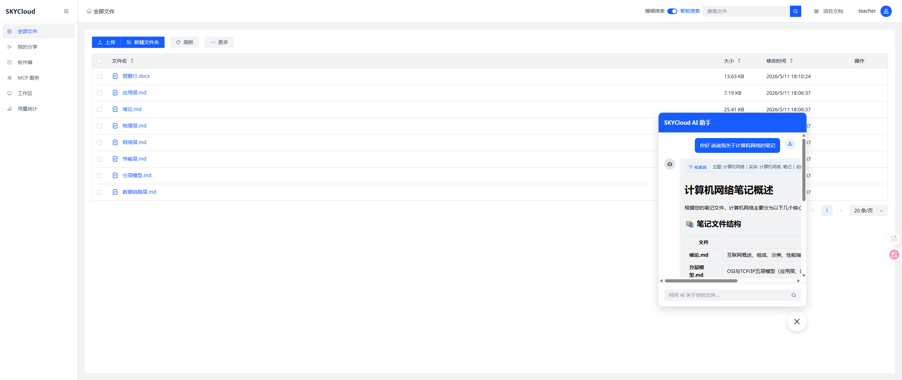
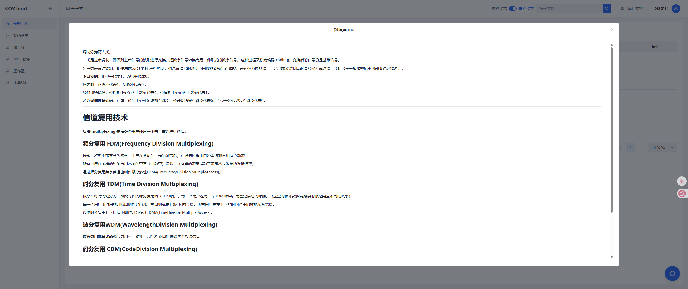
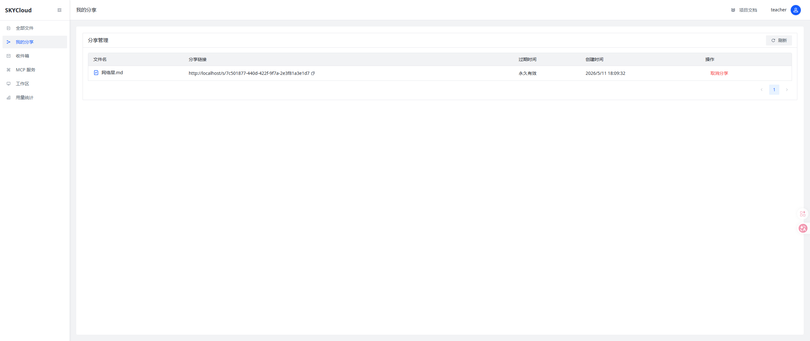
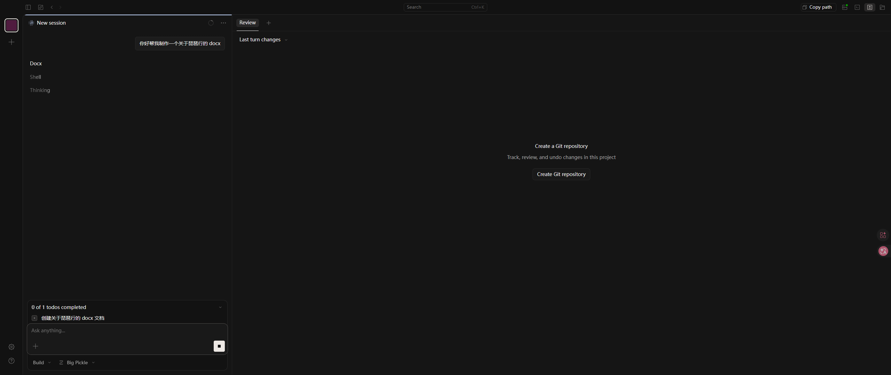
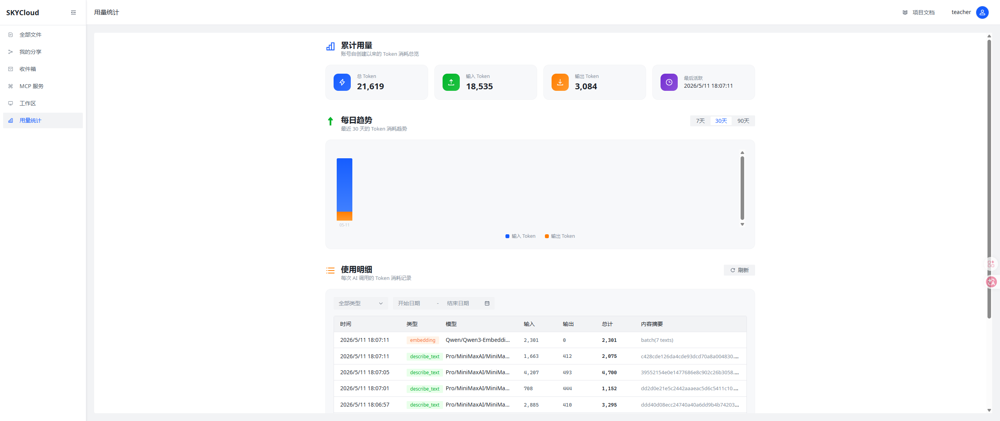
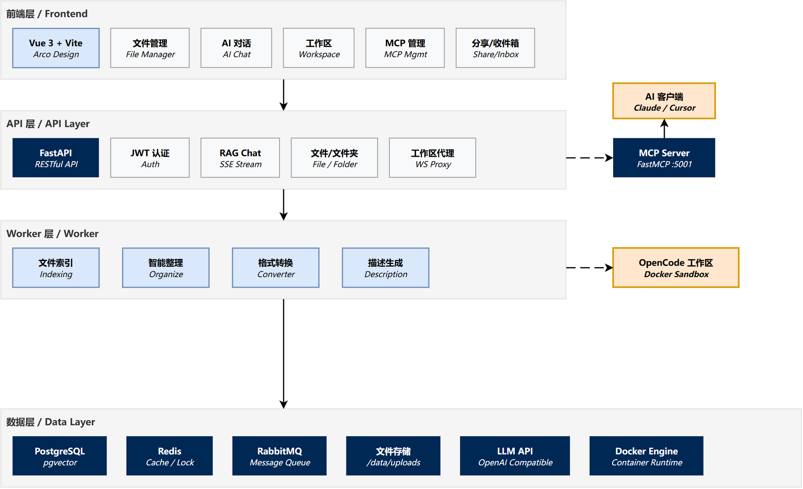

<div align="center">
  <h1>SKYCLOUD</h1>
  <p><strong>AI-powered cloud file management platform</strong></p>
  <p>
    
    
    
    
    
    
  </p>
  <p><a href="./README.md">Chinese</a></p>
</div>

---

SKYCloud combines a cloud drive, retrieval-augmented Q&A and an AI that can act on its own: upload and preview files,
search your data in natural language, let AI organize the drive, and run code inside a per-workspace Docker sandbox.

## Features

- **File management** — Uploads (chunked / instant), downloads, previews, batch operations, folder trees, format
  conversion
- **AI chat (RAG)** — Multi-query vector recall → RRF fusion → optional rerank → SSE streaming output, with image
  references
- **Dual-mode assistant** — Quick mode reads the current workspace; expert mode drives a controlled OpenCode Runtime
  with tool calls, permission prompts, cancellation and diffs
- **AI file organization** — LangGraph ReAct agent classification, incremental / full modes, inbox notification when
  organization finishes
- **All-in-one workspace** — Isolated Docker sandbox plus MCP, so AI can read and write the drive, run code and
  automate tasks
- **MCP service** — 16 tools / 4 prompts / 2 resources, directly usable from Claude Desktop, Cursor and other clients
- **Sharing & inbox** — Expiring share links and system notifications
- **Token usage** — Consumption statistics for chat / indexing / organization, including an admin summary view

## Screenshots

| AI assistant chat                           | File preview                             |
|---------------------------------------------|------------------------------------------|
|  |  |

| Share management           | Workspace                          | Token usage                            |
|----------------------------|------------------------------------|----------------------------------------|
|  |  |  |

## Architecture



| Layer           | Technology                              |
|-----------------|-----------------------------------------|
| Backend         | FastAPI · SQLAlchemy · Pydantic         |
| AI              | LangChain · LangGraph · OpenAI-compatible API |
| Vector store    | PostgreSQL 15 + pgvector (1024 dimensions) |
| Queue / cache   | RabbitMQ 3.13 · Redis 7                 |
| Frontend        | Vue 3 · TypeScript · Vite · Arco Design |
| MCP             | FastMCP (Streamable HTTP)               |
| Deployment      | Docker Compose                          |

## Quick Start

Requires uv 0.13.0 (using Python 3.11), Docker and Docker Compose; runtime hosts may be amd64 or arm64.

```bash
git clone https://github.com/TianyaSKY/SKYCloud && cd SKYCloud
cp .env.example .env
# Edit .env and configure the 6 model parameters for Chat and Embedding (CHAT_* / EMB_*)
uv run --no-project python scripts/start.py
docker compose exec backend-api python -m entry.bootstrap_admin --username admin
```

Then open `http://app.skycloud.localhost` (default port 80). The administrator is created interactively by the command
above.

The unified startup script `scripts/start.py` automatically initializes system secrets (persisted in `.skycloud/generated.env` with private mode 0600 permissions), verifies or builds runtime and MinIO images, and starts Docker Compose. When moving Docker hosts or requiring a rebuild, run `uv run --no-project python scripts/start.py --rebuild-images`.

To customize external ports, domain, HTTPS, or resource limits, copy `.env.advanced.example` to `.env.advanced`. If upgrading from a previous version with 86 environment variables, run `uv run --no-project python scripts/migrate-env.py` to seamlessly migrate existing credentials and configurations. See [deployment](docs/en/deployment.md) for secrets, database upgrades, and shutdown procedures.

## Documentation

| Document                                                    | Contents                                                      |
|-------------------------------------------------------------|---------------------------------------------------------------|
| [Deployment and operations](docs/en/deployment.md)          | Image builds, secrets and admins, database upgrades, shutdown |
| [Security model](docs/en/security.md)                       | Runtime isolation, auth and sessions, permissions, MCP credentials |
| [AI capabilities](docs/en/ai.md)                            | RAG retrieval, dual-mode assistant, MCP access, workspaces    |
| [Operating conventions](docs/en/operations.md)              | Uploads and quotas, background jobs, time zones, API and logging |
| [Local development](docs/en/development.md)                 | Running locally, tests, dependency management and CI               |

Chinese documentation: [README.md](README.md) and [docs/](docs/).

## Project Structure

```
SKYCloud/
├── backend/
│   ├── app/
│   │   ├── api/                # HTTP entry points: auth, dependencies, router assembly
│   │   ├── features/           # Domain modules (file / folder / share / chat / assistant / workspace …)
│   │   ├── mcp/                # MCP protocol adapter: tools, resources, auth, audit
│   │   ├── infra/              # Queue, cache, uploads, indexing, model calls
│   │   ├── models/             # SQLAlchemy models
│   │   └── exceptions.py       # Shared exceptions
│   ├── entry/                  # Process entry points: API / Worker / MCP / migrate / admin commands
│   ├── migrations/             # Alembic baseline (0001_rebuild; fresh databases only)
│   ├── runtime_common/         # Shared backend/Controller protocol and transport
│   ├── runtime_controller/     # Runtime container controller (standalone service)
│   ├── runtime_image/          # Expert Runtime sandbox image
│   └── tests/                  # Unit and integration tests
├── frontend/src/               # Vue 3 app (api / components / views / stores / router)
├── scripts/                    # Unified startup, env generation, migration, image builds
├── docs/                       # Chinese documentation (docs/en for English)
├── pyproject.toml              # Python dependencies, dependency groups and tool config
├── uv.lock                     # The single Python lockfile
├── docker-compose.yml
├── .env.example                # Basic model configuration template (6 items)
└── .env.advanced.example       # Optional advanced configuration template (ports, domain, quotas, etc.)
```

## License

MIT
